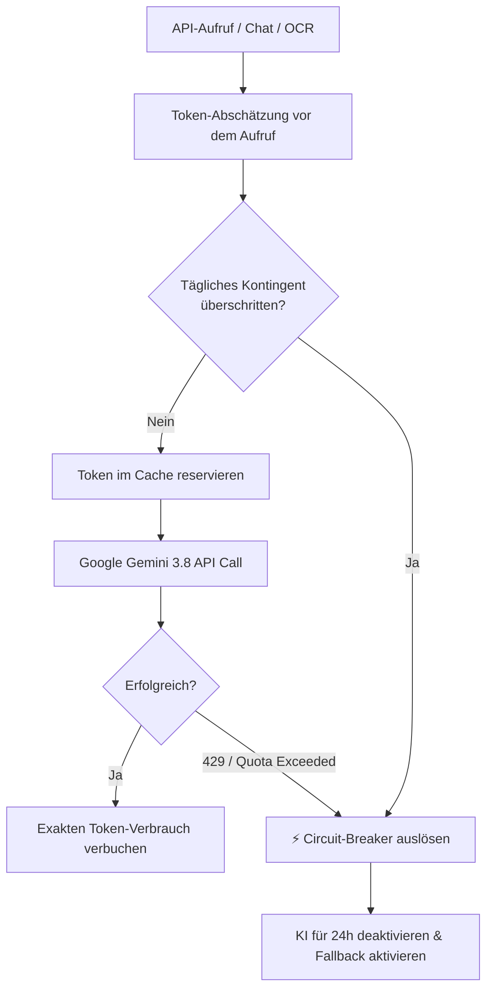

# Sicherheitsrichtlinie & Sicherheitsarchitektur (SECURITY.md)

Dieses Dokument definiert die Sicherheitsrichtlinien, Schutzmechanismen und architektonischen Schutzmaßnahmen für das **Dominik Flüchter Portfolio** (Backend, Frontend, Cloud-Infrastruktur und Ingestion-Pipelines).

---

## 1. Leitprinzipien (Defense in Depth)

Die Sicherheitsarchitektur folgt dem Prinzip der mehrschichtigen Verteidigung (*Defense in Depth*):
1. **Zero-Trust für Benutzereingaben**: Strikte Validierung auf Schema-, Type- und Inhalts-Ebene vor jeder Verarbeitung.
2. **Zero-Cost-Garantie für Cloud-KI**: Harte Token-Limits, Budget-Reservierungen und automatische Circuit-Breaker schließen unkontrollierte API-Kosten aus.
3. **Unveränderlichkeit sensibler Quellbestände**: Strikt schreibgeschützte Quellverzeichnisse für Urkunden und Zertifikate.
4. **Datensparsamkeit & Least Privilege**: Zugriffsbeschränkungen auf minimal notwendige Rollen und Scopes.

---

## 2. Strikt geschützter Quellordner (`CERTIFICATES_PATH`)

> [!CAUTION]
> **Höchste Schutzstufe für Quelldateien:** Der über die Umgebungsvariable `CERTIFICATES_PATH` definierte Pfad ist für alle Agenten, Sub-Agenten, Services und Skripte **STRIKT READ-ONLY**.

### Zwingende Sicherheitsregeln:
- **Keine Modifikation:** Quelldateien dürfen unter keinen Umständen überschrieben, umbenannt, editiert oder verschoben werden (`no in-place write`, `no truncate`).
- **Absolutes Löschverbot:** Das Löschen von Dateien oder Verzeichnissen in diesem Pfad ist strikt untersagt (`os.remove`, `Path.unlink`, `shutil.rmtree`, `del`, `rm` etc.).
- **Ausschließlich lesender Zugriff:** Erlaubt sind ausschließlich Leseoperationen (Berechnung des SHA-256-Hashes, Text- und Metadaten-Extraktion, Read-Streams zur Übertragung in den Supabase S3-Storage).
- **Physische Integrität:** Alle Import-Pipelines (`scan_inbox`, `import_certificates`) arbeiten idempotent und belassen Quelldateien unberührt am Ursprungsort.

---

## 3. Authentifizierung & Autorisierung (RBAC)

### 3.1 Authentifizierungs-Stack & Core Security

* **Custom User Model (`portfolio.User`)**: Die Anmeldung nutzt ausschließlich eine eindeutige E-Mail-Adresse (kein Nutzername).
* **Geschlossene Registrierung**: Öffentliche Registrierungsendpunkte (`POST /api/auth/users/`) sind mittels `IsAdminUser` blockiert. Administrator-Accounts werden manuell über den Befehl `createsuperuser` angelegt.
* **Passwort-Reset & Session-Sync**: Bietet einen Single-User-Reset-Flow über das Login-Modal und eine gesicherte Bestätigungsseite (`/password/reset/confirm/:uid/:token`). Bei abgelaufenem Refresh-Token sichert ein Axios-Interceptor den sauberen Logout via `auth:unauthorized`.

- **JWT-Architektur:** Implementiert via `djangorestframework-simplejwt` und `djoser`.
- **Token-Lebenszyklen:**
  - `ACCESS_TOKEN_LIFETIME`: 60 Minuten (kurzlebig zur Begrenzung von Replay-Risiken).
  - `REFRESH_TOKEN_LIFETIME`: 7 Tage (mit automatischem Token-Blacklisting bei Rotation und Logout).
- **Passwort-Hashing:** Verwendung von PBKDF2 mit SHA-256 und mindestens 600.000 Iterationen (gemäß OWASP-Empfehlung).

### 3.2 Rollenbasierte Zugriffskontrolle (RBAC)
| Ressource / Endpoint | Berechtigungsklasse | Beschreibung |
|---|---|---|
| `GET /api/projects/`, `GET /api/skills/`, `GET /api/tracks/` | `AllowAny` / `IsAuthenticatedOrReadOnly` | Öffentliche Portfolio-Daten für Besucher |
| `POST /api/chat/` | `AllowAny` (Rate-Limited) | Öffentlicher Portfolio-Assistent |
| `POST /api/certificates/`, `PATCH /api/certificates/{id}/` | `IsAuthenticated` | Nur authentifizierte Administratoren |
| `POST /api/certificates/{id}/extract_metadata/` | `IsAuthenticated` | On-Demand OCR & KI-Extraktion |
| `/api/pending-certificates/` | `IsAdminUser` | Inbox-Management & Freigabe-Workflows |
| `GET /api/pending-certificates/{id}/file/` | `IsAdminUser` | Geschützter Stream der Originaldatei |
| `/admin/` (Django Systemverwaltung) | `IsAdminUser` (`is_staff=True`) | Administratives Backend mit Session-Auth |

---

## 4. API-Sicherheit, Throttling & Zero-Cost Circuit Breaker

### 4.1 Rate Limiting (DRF Throttling)
Zur Abwehr von Denial-of-Service-Angriffen (DoS) und API-Missbrauch:
- **Portfolio-Chatbot (`/api/chat/`):** Scoped Rate Limiting auf **20 Anfragen / Minute** pro IP (`ScopedRateThrottle`).
- **Auth-Endpunkte (`/api/auth/jwt/create/`):** Schutz vor Brute-Force-Angriffen durch IP- und Account-basierte Anfragelimits.

### 4.2 Zero-Cost AI Circuit Breaker ([`ai_assistant.py`](file:///d:/dev/portfolio_project/backend/portfolio/services/ai_assistant.py))
Um unerwartete Kosten durch Cloud-KI-Aufrufe (Google Gemini 3.8 Flash) garantiert auszuschließen:

- **Tägliches Token-Budget:** Standardmäßig `DEFAULT_DAILY_TOKEN_LIMIT = 50.000` Tokens pro 24 Stunden.
- **Tägliches Anfrage-Limit:** Max. 100 KI-Anfragen pro Tag.
- **Automatischer Schutz:** Bei HTTP 429 (`RESOURCE_EXHAUSTED`) oder Budget-Erreichung wird die KI-Komponente für 24 Stunden gesperrt; alle Kernfunktionen des Portfolios bleiben uneingeschränkt nutzbar.

---

## 5. KI-Sicherheit & Prompt-Injection Schutz

### 5.1 Pre-Flight Injection Filter
Eingehende Chatbot-Prompts werden vor der Weiterleitung an das LLM durch reguläre Ausdrücke (`INJECTION_REGEX`) auf bösartige Kontrollsequenzen geprüft (0 Token-Verbrauch):
- Filtert bekannte Jailbreak-Muster (`DAN mode`, `ignore previous instructions`, `system prompt`, `reveal instructions`, `override instructions`).
- Schlägt der Filter an, wird die Anfrage sofort abgewiesen, ohne dass externe API-Aufrufe erfolgen.

### 5.2 Eingabe- und Ausgabe-Guardrails
- **Längenbegrenzung:** Chatbot-Eingaben sind strikt auf maximal 500 Zeichen limitiert.
- **Grounding-Garantie:** Das System instruiert Gemini 3.8 Flash strikt auf die interne Portfolio-Wissensbasis (`Grounding Context`). Erfundene Daten oder Halluzinationen sind untersagt.
- **Schutz vor System-Prompt-Leaks:** Antworten werden auf sensible interne Token- und Schlüsselmuster gefiltert.

---

## 6. Transport- & Netzwerk-Sicherheit

### 6.1 HTTPS & Strict Transport Security (HSTS)
In der Produktionsumgebung (`DEBUG=False` auf Render):
- `SECURE_SSL_REDIRECT = True`: Automatischer Redirect aller HTTP-Anfragen auf HTTPS.
- `SECURE_HSTS_SECONDS = 31536000`: HSTS mit einer Mindestdauer von 1 Jahr.
- `SECURE_HSTS_INCLUDE_SUBDOMAINS = True` & `SECURE_HSTS_PRELOAD = True`.
- `SECURE_PROXY_SSL_HEADER = ('HTTP_X_FORWARDED_PROTO', 'https')`: Korrekte TLS-Terminierung hinter dem Render-Reverse-Proxy.

### 6.2 Cookie-Sicherheit
- `SESSION_COOKIE_SECURE = True` & `CSRF_COOKIE_SECURE = True`.
- `SESSION_COOKIE_HTTPONLY = True`: Verhindert den Zugriff auf Session-Cookies über JavaScript (XSS-Schutz).
- `SESSION_COOKIE_SAMESITE = 'Lax'` & `CSRF_COOKIE_SAMESITE = 'Lax'`.

### 6.3 CORS & CSRF Whitelisting
- Keine Wildcard-Freigaben (`CORS_ALLOW_ALL_ORIGINS = False`).
- Streng definierte Whitelists für vertrauenswürdige Produktions- und Staging-Domains:
  - `CORS_ALLOWED_ORIGINS`: `https://dfluechter.ipv64.de`, `https://dfluechter.onrender.com`.
  - `CSRF_TRUSTED_ORIGINS`: `https://dfluechter.ipv64.de`, `https://dfluechter.onrender.com`.

### 6.4 Security Header
- `X-Content-Type-Options: nosniff`: Verhindert MIME-Type-Sniffing.
- `X-Frame-Options: DENY`: Schutz vor Clickjacking.
- `Referrer-Policy: strict-origin-when-cross-origin`.

---

## 7. Cloud- & Datenbank-Sicherheit

### 7.1 Neon Serverless PostgreSQL
- **TLS/SSL erzwungen:** Alle Datenbankverbindungen verlangen `sslmode=require` und `channel_binding=require`.
- **Verbindungstrennung:**
  - `DATABASE_URL` nutzt PgBouncer-Pooler (`-pooler`) für hochgradig skalierende Web-Workloads.
  - `DIRECT_DATABASE_URL` umgeht den Pooler für migrationskritische DDL-Operationen (`python manage.py migrate`).
- **Ephemere CI-Isolation:** In GitHub Actions Pipelines werden bei jedem Testlauf isolierte Neon-Branches erstellt und nach Testende rückstandslos gelöscht.

### 7.2 Supabase S3 Object Storage
- **Dateivalidierung:** Hochgeladene Zertifikate werden streng validiert:
  - Zulässige Dateiendungen: `.pdf`, `.png`, `.jpg`, `.jpeg`.
  - Maximale Dateigröße: 10 MB (`validate_file_size`).
- **SHA-256 Duplikatsprüfung:** Jede Datei wird kryptografisch gehasht; identische Binärdateien werden verworfen.
- **CORS-Policies:** Direct-to-Storage Uploads erlauben `PUT` ausschließlich von autorisierten Portfolio-Domains.

---

## 8. Secret Management & CI/CD Governance

- **Zero-Secret-Policy im Code:** Keine Passwörter, Tokens oder API-Keys im Git-Repository. Die Datei `.env` ist strikt in `.gitignore` geführt.
- **Deklaratives Render Blueprint ([`render.yaml`](file:///d:/dev/portfolio_project/render.yaml)):**
  - Alle sensiblen Umgebungsvariablen sind mit `sync: false` deklariert und müssen über das Render-Dashboard gepflegt werden.
- **Code Ownership ([`.github/CODEOWNERS`](file:///d:/dev/portfolio_project/.github/CODEOWNERS)):**
  - Kritische Sicherheits- und Infrastrukturpfade (`/backend/core/settings.py`, `.github/workflows/`, `/render.yaml`) sind geschützt und verlangen Pflicht-Reviews von Code-Ownern.

---

## 9. Melden von Sicherheitslücken (Responsible Disclosure)

Solltest du eine Sicherheitslücke oder eine Schwachstelle in diesem Portfolio oder seinen Services entdecken, bitten wir um verantwortungsvolle Offenlegung (*Responsible Disclosure*):

1. **Nicht öffentlich melden:** Bitte erstelle keine öffentlichen GitHub Issues für Sicherheitslücken.
2. **Direkter Kontakt:** Sende die Details vertraulich per E-Mail an:
   - **E-Mail:** `dominik.fluechter@googlemail.com`
   - **Betreff:** `[SECURITY] Schwachstelle im Portfolio-Projekt`
3. **Inhalt der Meldung:**
   - Detaillierte Beschreibung der Schwachstelle.
   - Schritte zur Reproduktion (Proof-of-Concept).
   - Mögliche Auswirkungen.

Wir bemühen uns um eine Rückmeldung innerhalb von **48 Stunden** und eine zügige Behebung.
