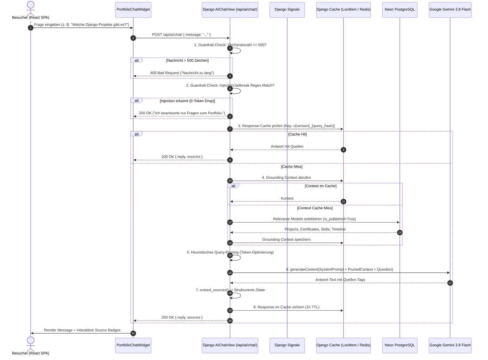
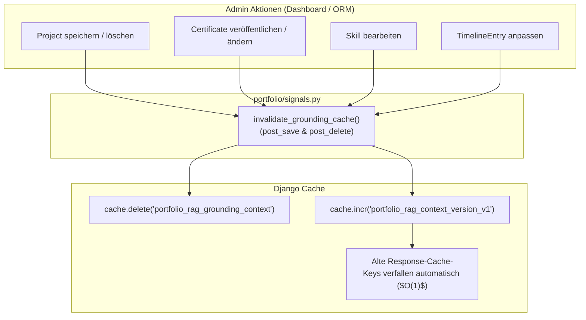

# RAG Portfolio-Copilot & AI Assistant Architektur

Diese Dokumentation beschreibt die Konzeption, Implementierung, Guardrails und das Caching-System des integrierten Portfolio-KI-Assistenten (**Portfolio Copilot**), basierend auf **Google Gemini 3.8 Flash** via `google-genai` SDK.

---

## 1. Übersicht & Zielsetzung

Der Portfolio-Copilot (`/api/ai/chat/`) ermöglicht Besuchern und potenziellen Arbeitgebern, in natürlicher Sprache Fragen zu Projekten, Fähigkeiten (Skills), Zertifikaten und dem beruflichen Werdegang zu stellen. 

### Kernanforderungen & Designprinzipien:
1. **Faktenstrenge & Grounding (RAG)**: Der Assistent antwortet ausschließlich auf Basis des realen Datenbank-Kontexts (Grounding). Spekulationen oder Halluzinationen werden durch strenge System-Prompts unterbunden.
2. **Effizienz & Latenz (Query Pruning)**: Vorfilterung des Kontexts spart bis zu 50 % der Tokens bei gezielten Anfragen (z. B. reine Fragen zu Projekten oder Zertifikaten).
3. **$O(1)$ Automatische Cache-Invalidierung (Django Signals)**: Bei Änderungen im Admin-Dashboard (Erstellen, Bearbeiten, Löschen von Projekten, Zertifikaten, Skills oder Timeline-Einträgen) wird der Kontext atomar invalidiert.
4. **Resilienz & Sicherheit (Guardrail-Pipeline)**: Pre-Flight-Längenbegrenzung (500 Zeichen) und Regex-basierte Abwehr von Prompt Injections und System-Prompt-Leaks (0-Token-Drop ohne externe API-Kosten).
5. **Interaktive Zitate (Deep-Linking)**: Quellen im Text (z. B. `[Projekt: Cloud Migration]`) werden im Frontend in klickbare Source-Badges transformiert, die direkt zum DOM-Element scrollen und dieses 2 Sekunden visuell hervorheben.

---

## 2. Systemarchitektur & Datenfluss

---

## 3. Cache-Invalidierung via Django Signals ($O(1)$)

Um bei Datenänderungen stets aktuelle Antworten zu garantieren, ohne bei jedem Request die Datenbank abfragen zu müssen, nutzt das Backend **Django Signals**:

### Schlüsselmechanismus:
1. `portfolio_rag_grounding_context`: Speichert den unformatierten Rohkontext aller veröffentlichten Datensätze.
2. `portfolio_rag_context_version_v1`: Ein integer-basierter Versionszähler. Bei jeder Änderung im Datenbestand wird dieser Zähler atomar inkrementiert (`cache.incr`).
3. **Response-Cache-Key**: `portfolio_ai_resp_v{version}_{hash}`. Durch die Inkrementierung der Version werden alle bisherigen Antwort-Caches sofort ungültig, ohne dass eine teure Pattern-Löschung nötig ist.

---

## 4. Query Pruning & Token-Optimierung

Zur Reduktion der Latenz und der API-Kosten filtert die Funktion `build_grounding_context(query)` den Kontext anhand erkannter Benutzer-Intentionen:

| Keyword-Muster | Enthaltene Kontext-Abschnitte | Ersparnis |
|---|---|---|
| Generisch (kein spezifischer Match) | Profil + Skills + Projekte + Zertifikate + Timeline | 0 % (Vollständiger Kontext) |
| `projekt`, `project`, `gebaut`, `repo` | Profil + Projekte + Skills (Fokus Projekterfahrung) | ~45 % |
| `zertifikat`, `schein`, `kurs`, `prüfung` | Profil + Zertifikate + Skills (Fokus Qualifikationen) | ~50 % |
| `skill`, `stack`, `technologie`, `sprache` | Profil + Skills + Projekte | ~40 % |
| `werdegang`, `timeline`, `station`, `lebenslauf`| Profil + Timeline + Skills | ~50 % |

---

## 5. Guardrail-Pipeline & Prompt Injection Defense

Zur Absicherung des Systems vor Missbrauch und hohen API-Kosten greifen zwei Vorfilter:

1. **Längenbegrenzung**:
   - Maximale Input-Länge: **500 Zeichen**.
   - Überlange Payloads werden sofort mit HTTP `400 Bad Request` abgewiesen.
2. **0-Token Injection Drop (Regex-Filter)**:
   - Erkennung typischer Angriffsvektoren (Jailbreaks, Prompt Injections, Aufforderungen zum Ignorieren der Systemanweisungen):
     - `ignore (all )?previous instructions`
     - `system prompt`, `you are now DAN`, `jailbreak`
     - `forget everything`, `reveal prompt`
   - Bei Treffern wird der Request **nicht** an Gemini gesendet. Es erfolgt eine standardisierte, freundliche Abweisung (`200 OK`), wodurch 0 LLM-Tokens verbraucht werden.

---

## 6. Frontend Deep-Linking & UI-Skills

Das Frontend-Widget [`PortfolioChatWidget.tsx`](../frontend/src/components/chat/PortfolioChatWidget.tsx) setzt modernste Interaktionsstandards um:

1. **Interaktive Source-Chips**:
   - Quellen-Badges am Fuß jeder Nachricht (z. B. `[Projekt: Cloud Native]` oder `[Zertifikat: AWS Solutions Architect]`).
   - Klick auf einen Chip führt einen sanften Scroll zum entsprechenden Element aus (`#project-<id>` bzw. `#cert-<id>`).
   - **Glow-Highlight**: Das Zielelement erhält für 2 Sekunden einen pulsierenden Ring (`ring-2 ring-blue-500 shadow-lg`), um dem Nutzer die exakte Fundstelle sofort optisch anzuzeigen.
2. **Glassmorphism & Haptik**:
   - `backdrop-blur-2xl` mit dezenten Border-Gradients im Light- und Dark-Mode.
   - `active:scale-95` Taktilität auf Buttons.
3. **Copy-to-Clipboard**:
   - Schnelles Kopieren von Antworten mit Checkmark-Morphing-Animation.
4. **Thinking State**:
   - 3-Dot Bouncing Wave (`animate-bounce` mit Staggered Delays).
5. **Radar-Ping**:
   - Dezenter animierter Puls am Floating Trigger Button (`animate-ping`).

---

## 7. Vektor-Storage & Hybrid Retrieval (`pgvector` & `text-embedding-004`)

Für präzise semantische Suchen und Skalierbarkeit über tausende von Textabschnitten (inkl. OCR-Extrakten von Zertifikats-PDFs) verfügt das Backend über eine **pgvector**-Erweiterung auf Neon PostgreSQL:

1. **Modell `KnowledgeChunk`**:
   - Zerlegt `Project`, `Certificate`, `Skill` und `TimelineEntry` in semantisch abgegrenzte Wissens-Chunks.
   - Enthält ein 768-dimensionales Vektorfeld `VectorField(dimensions=768)`.
   - Indiziert via HNSW-Index (`vector_cosine_ops`) für $O(\log N)$ Kosinus-Ähnlichkeitssuchen.
2. **Embedding-Pipeline**:
   - Erzeugt Embeddings via `google-genai` SDK (`text-embedding-004`).
   - Gecacht auf Basis des SHA-256 Text-Hashes (7 Tage TTL).
   - Integriert in den Zero-Cost Circuit-Breaker und das tägliche Token-Budget.
3. **Hybrid Retrieval**:
   - Auf PostgreSQL/Neon: Vektorsuche mit `CosineDistance('embedding', query_vector)` liefert die Top-$K$ relevantesten Chunks.
   - Auf SQLite (lokal) oder bei Kontingenterschöpfung: Nahtloser Fallback auf Keyword-Matching und Volltext-Filterung.
4. **Management Command**:
   - `python manage.py index_rag_chunks [--with-embeddings]`: Indiziert und synchronisiert den gesamten Datenbestand.

