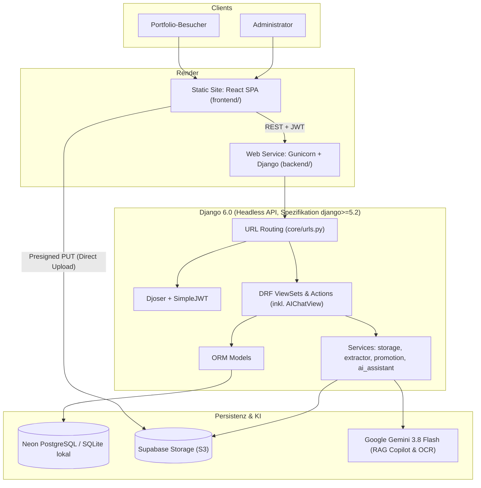
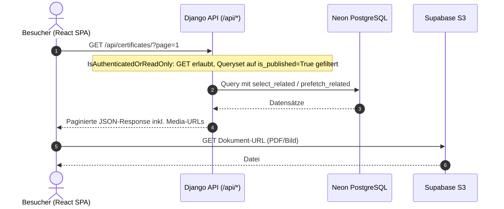
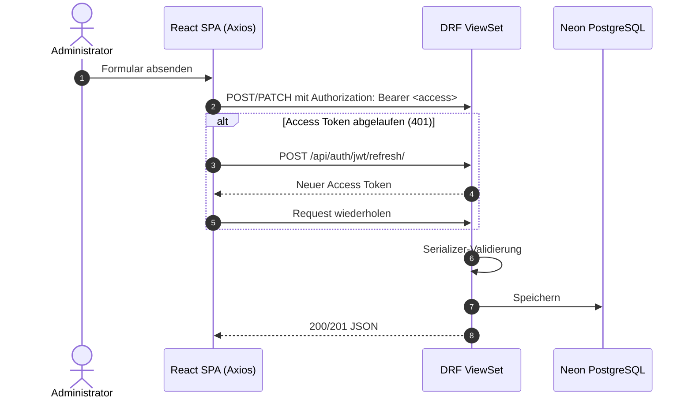
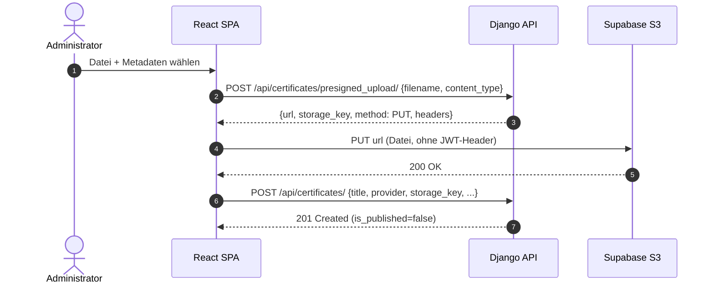

# System- und Architektur-Dokumentation

Diese Dokumentation beschreibt Architektur, Datenfluss, API-Endpunkte sowie das Authentifizierungs- und Sicherheitskonzept des Portfolios.

Weiterführend: [Frontend-Architektur](frontend.md) · [RAG Portfolio-Copilot](ai-assistant-rag.md) · [Deployment & Operations](deployment.md) · [Sicherheitskonzept](SECURITY.md) · [Glossar](glossary.md) · [Backlog](backlog.md) · [ADRs](adrs/) · [GitHub Wiki](https://github.com/dfluechter/portfolio_project/wiki)

---

## 1. Systemübersicht & Komponenten

Das Projekt ist als **Monorepo** organisiert ([ADR-001](adrs/001-monorepo.md)). Django dient seit [ADR-006](adrs/006-resolving-technical-debt-and-security.md) ausschließlich als **Headless-JSON-API**; die gesamte Benutzeroberfläche (öffentliches Portfolio und Admin-Dashboard) ist die React-SPA.

### Kerntechnologien

| Schicht | Technologie | Zweck |
|---|---|---|
| Backend | Python 3.13 / Django 6.0 (Spezifikation `django>=5.2`) / DRF | REST-API und Geschäftslogik |
| Paketmanagement | `uv` | Reproduzierbare Abhängigkeiten |
| Frontend | React 19 / TypeScript / Vite / Tailwind CSS v4 | Öffentliche Seite, Chatbot & Admin-Dashboard |
| Datenbank | Neon Serverless PostgreSQL + `pgvector` (Prod) / SQLite (Dev) | Relationale Daten & 768-dim. Vektorspeicher (HNSW) |
| KI / LLM | Google Gemini & `text-embedding-004` via `google-genai` | RAG Portfolio-Copilot (`/api/ai/chat/`), Hybrid Retrieval & OCR |
| Media | Supabase Storage (S3-kompatibel, `django-storages` + `boto3`) | Zertifikatsdokumente |
| Statische Dateien | WhiteNoise | Auslieferung der Django-Static-Files (Swagger-UI, Admin) |
| OCR | `pypdf`, `pytesseract`, Gemini 3.8 Flash (`google-genai` SDK) | Zweistufige Metadaten-Extraktion & OCR-Fallback |
| Hosting | Render (Web Service + Static Site) | Deployment, siehe [deployment.md](deployment.md) |

---

## 2. Datenfluss

### 2.1 Öffentliche Leseanfragen

Zustandslos, ohne Login. Unauthentifizierte Anfragen sehen nur veröffentlichte Datensätze (`is_published=True` bei Zertifikaten und Projekten).

### 2.2 Administrativer Schreibzugriff

### 2.3 Datei-Upload & Media-Handling

Es gibt drei Wege, wie eine Datei in den Storage gelangt:

| Weg | Auslöser | Ablauf |
|---|---|---|
| **A: Multipart-Upload** | `POST /api/certificates/` mit `pdf_file` | Datei läuft durch Django, Validierung im Serializer, Speicherung via `default_storage`. |
| **B: Direct-to-Storage** | Dashboard „Zertifikat hochladen“ | Browser lädt per Presigned URL direkt nach S3, Django erhält nur den `storage_key` (siehe Diagramm). |
| **C: Inbox/Import** | Management-Commands, `approve`, `publish` | Datei wird strikt lesend aus `CERTIFICATES_PATH` bzw. Inbox gelesen und in den Storage kopiert. |

> [!NOTE]
> **Serverseitige Härtung für Weg B (User Story 10.2):** Bei Registrierung eines per Direct-to-Storage hochgeladenen Zertifikats (`storage_key`) verifiziert das Backend das Objekt in Supabase S3 via `head_object` (Existenz & Max. 10 MB), prüft per Range-Request (`bytes=0-2047`) die echten Magic Bytes (`%PDF`, `\x89PNG`, `\xFF\xD8\xFF`) und berechnet bzw. validiert den SHA-256-Hash serverseitig.

**Validierung (Wege A und C):**
- `validate_file_extension`: Endungen `.pdf`, `.png`, `.jpg`, `.jpeg` **und** Prüfung der Magic Bytes (`%PDF`, `\x89PNG`, `\xFF\xD8\xFF`) gegen Endungs-Spoofing.
- `validate_file_size`: maximal 5 MB.

**Speicherpfade:**
- Wege A/C: `certificates/<provider-slug>/<sha256[:12]>/<dateiname>`; leerer Slug → `unsorted`.
- Weg B: `certificates/uploads/<uuid12>_<dateiname-slug><ext>`.

**S3-Konfiguration** (aktiv bei `USE_SUPABASE_S3=True`):
- Pfad-Adressierung (`addressing_style=path`) und Signatur `s3v4` sind für Supabase Pflicht.
- `AWS_S3_PUBLIC_BUCKET` steuert die URL-Art: `True` → öffentliche, dauerhafte URLs; `False` → signierte, ablaufende URLs (`querystring_auth`).
- `file_overwrite=False` verhindert stilles Überschreiben.
- Für Weg B muss im Bucket eine **CORS-Regel** für die Frontend-Domain hinterlegt sein, siehe [deployment.md](deployment.md#5-supabase-storage-cors-konfiguration-für-direct-to-storage-uploads).

### 2.4 Dual-Database Architektur & Connection Routing

Das Backend implementiert ein dynamisches Routing zwischen Neon PostgreSQL und lokalem SQLite:
- **Produktion / Neon PostgreSQL:**
  - **Gepoolte Verbindung (`DATABASE_URL`):** Verbindet über den Neon PgBouncer-Pooler (`-pooler` Host). Dient dem regulären Gunicorn-Webbetrieb zur ressourceneffizienten Skalierung (`conn_max_age=600`, `conn_health_checks=True`).
  - **Direkte Verbindung (`DIRECT_DATABASE_URL`):** Direkte Verbindung zum Neon-Compute-Endpunkt ohne PgBouncer. Da DDL-Migrationen exklusive Transaktionssperren und vorbereitete Statements erfordern, schaltet `backend/core/settings.py` bei Migrations-Befehlen (`migrate`, `makemigrations`, `showmigrations`, `sqlmigrate` via `IS_MIGRATION_COMMAND` bzw. `RUNNING_MIGRATION=1`) automatisch auf `DIRECT_DATABASE_URL` um (Details siehe [deployment.md §2.3](deployment.md#23-neon-postgresql-trennung-von-pooled--und-direct-connection)).
- **Lokale Entwicklung & Fallback (SQLite):**
  - Ist weder `DATABASE_URL` noch `DIRECT_DATABASE_URL` gesetzt, greift `dj_database_url` automatisch auf die lokale SQLite-Datenbank (`backend/db.sqlite3`) zurück.
- **pgvector vs. SQLite Kompatibilität:**
  - **Neon PostgreSQL:** Migration `0014_knowledgechunk_pgvector` aktiviert bedingt `CREATE EXTENSION IF NOT EXISTS vector;` und baut einen performanten HNSW-Index (`using hnsw (embedding vector_cosine_ops)`). Das Retrieval in `portfolio/services/retrieval.py` nutzt native Vektor-Distanzsuchen (`CosineDistance`).
  - **SQLite:** Das `VectorField` in `portfolio/models.py` deklariert auf SQLite transparent den Datenbanktyp `text`. Beim Retrieval greift automatisch ein robuster Keyword-Fallback (`Q(title__icontains=...) | Q(content__icontains=...)`), sodass sämtliche Tests und Entwicklungs-Workflows ohne externe Abhängigkeiten auf SQLite laufen.
- **Test-Isolation:** Tests laufen deterministisch mit `core.settings_test` (definiert in `backend/pytest.ini`).

### 2.5 RAG Portfolio-Copilot, Native `pgvector` Hybrid Retrieval, Signals Caching & Deep-Linking

Für interaktive Besucherfragen steht der Portfolio-Copilot bereit (`POST /api/ai/chat/`).
- **LLM & Embeddings**: Google Gemini & `text-embedding-004` (768 Dimensionen) via `google-genai` SDK.
- **Vektorspeicher & Hybrid Retrieval (`KnowledgeChunk`)**: Alle veröffentlichten Entitäten (`Project`, `Certificate` inkl. OCR-Volltexten, `Skill`, `TimelineEntry`) werden als semantische Chunks in `KnowledgeChunk` gespeichert und auf Neon PostgreSQL über einen `pgvector` HNSW-Index (`vector_cosine_ops`) via `CosineDistance` durchsucht (mit automatischem Keyword-Fallback auf SQLite).
- **Query-Pruning**: Zusätzlich werden irrelevante Sektionen im Basis-Kontext anhand der Frage-Intention herausgefiltert, wodurch bis zu 50 % der Kontext-Tokens eingespart werden.
- **$O(1)$ Signal-basierte Cache-Invalidierung & Live-Sync**: Django Signals (`post_save`, `post_delete` in `portfolio/signals.py`) synchronisieren die `KnowledgeChunk`-Einträge in Echtzeit, invalidieren den Rohkontext und inkrementieren atomar die Version `portfolio_rag_context_version_v1`.
- **Guardrails & Zero-Cost Circuit-Breaker**: Pre-Flight Input-Limitierung auf 500 Zeichen, Regex-Filter zur Erkennung von Prompt Injections/Jailbreaks (0-Token Drop ohne LLM-Aufruf) und tägliche Token-/Request-Budgetierung.
- **Deep-Linking**: Generierte Antworten enthalten Quellhinweise, die vom Frontend in klickbare Badges umgewandelt werden (`#project-<id>`, `#cert-<id>`) und das Ziel für 2 Sekunden optisch hervorheben.
- Ausführliche Dokumentation: siehe [docs/ai-assistant-rag.md](ai-assistant-rag.md) und [ADR-007](adrs/007-rag-copilot-caching-guardrails.md).

### 2.6 HTTP Conditional Caching & ETag-Strategie (Epic 15)

Um Datenbank-Queries auf Neon und Rechenzeit auf Render minimal zu halten, unterstützen alle öffentlichen Lese-Endpunkte (`/api/projects/`, `/api/tracks/`, `/api/skills/`, `/api/certificates/`) standardmäßiges HTTP Conditional Caching über das `ConditionalCacheMixin` (`backend/portfolio/views.py`):
- **ETag-Berechnung & Atomare Cache-Version:** Schwache ETags (`W/"<ressource>_v<version>"` bzw. bei Filterung `W/"<ressource>_v<version>_<query_hash>"`) basieren auf der atomaren Signal-Cache-Version `portfolio_rag_context_version_v1` (`RAG_VERSION_KEY`). Ändern sich Daten durch Mutationen (`post_save`/`post_delete`), inkrementieren die Django-Signals diese Version in $O(1)$.
- **`304 Not Modified` Fast-Path:** Sendet der Client den Header `If-None-Match`, prüft `ConditionalCacheMixin.check_conditional_cache` die Übereinstimmung für unauthentifizierte `GET`- und `HEAD`-Anfragen noch vor Ausführung teurer ORM-Datenbankabfragen und Serialisierungen. Bei Match wird unmittelbar ein leerer Response mit Status `304 Not Modified` ausgeliefert.
- **Cache-Control & Authentifizierungs-Bypass:**
  - Für unauthentifizierte Anfragen gilt `Cache-Control: public, max-age=300, stale-while-revalidate=60`.
  - Authentifizierte Requests (z. B. aus dem Admin-Dashboard) erhalten `Cache-Control: no-cache, private`, sodass Administratoren stets Live-Daten ohne Client-Caching erhalten.

---

## 3. API-Endpunkte

Die verbindliche, vollständige Spezifikation liefert das OpenAPI-Schema (`drf-spectacular`) unter `/api/docs/` (Swagger-UI) bzw. `/api/schema/`. Die folgenden Tabellen geben einen Überblick.

### 3.1 REST-API (`/api/`)

Standard-CRUD (`GET` Liste/Detail, `POST`, `PUT`, `PATCH`, `DELETE`) über den `DefaultRouter`.

| Ressource | Lesen | Schreiben | Besonderheiten |
|---|---|---|---|
| `/api/projects/` | Öffentlich (nur `is_published`) | Auth | – |
| `/api/providers/` | Öffentlich | Auth | `DELETE` liefert `409`, solange Zertifikate verknüpft sind |
| `/api/certificates/` | Öffentlich (nur `is_published`) | Auth | Paginierung & Filter, siehe 3.2 |
| `/api/skills/` | Öffentlich | Auth | – |
| `/api/timeline/` | Öffentlich | Auth | – |
| `/api/tracks/` | Öffentlich | Auth | Liefert verknüpfte Zertifikate sowie `icon` & lokale `icon_url` (FontAwesome Solid SVG) |
| `/api/pending-certificates/` | Nur Staff (`IsAdminUser`) | Nur Staff | Detail enthält `extracted_text`, Liste nicht |

**Custom Actions:**

| Endpunkt | Methode | Berechtigung | Zweck |
|---|---|---|---|
| `/api/ai/chat/` | `POST` | Öffentlich | RAG Portfolio-Copilot (Gemini 3.8 Flash mit Guardrails & Deep-Link Zitaten) |
| `/api/certificates/presigned_upload/` | `POST` | Auth | Signierte S3-Upload-URL für Direct-to-Storage (Weg B) |
| `/api/certificates/<id>/publish/` | `POST` | Auth | Prüft Track-Pflicht ($\ge 1$ Track), stellt Datei im Storage sicher und setzt `is_published=true` |
| `/api/certificates/<id>/unpublish/` | `POST` | Auth | Setzt `is_published=false` |
| `/api/certificates/<id>/extract_metadata/` | `POST` | Auth | On-Demand-OCR, liefert Vorschläge (überschreibt nichts) |
| `/api/pending-certificates/<id>/approve/` | `POST` | Staff | Überführt Inbox-Eintrag in ein `Certificate` |
| `/api/pending-certificates/<id>/reject/` | `POST` | Staff | Verwirft Inbox-Eintrag |
| `/api/pending-certificates/bulk_approve/` | `POST` | Staff | Batch-Freigabe mehrerer IDs (`ids: [...]`, optionale `track_ids: [...]`) |
| `/api/pending-certificates/bulk_reject/` | `POST` | Staff | Batch-Ablehnung mehrerer IDs (`ids: [...]`) |
| `/api/pending-certificates/<id>/file/` | `GET` | Staff | Liefert Originaldatei inline (`FileResponse`) für Vorschau & Show-File |

### 3.2 Paginierung & Filter für `/api/certificates/`

| Parameter | Werte | Wirkung |
|---|---|---|
| `page`, `page_size` | Zahl (Standard 20) | Serverseitige Paginierung |
| `no_page` / `all` | `true` | Unpaginierte Gesamtliste (Abwärtskompatibilität) |
| `is_published` | `true` / `false` | Nur für authentifizierte Nutzer wirksam |
| `incomplete` | `true` | Fehlendes `issued_date` oder generierter/unvollständiger Titel |
| `track` | ID oder Slug | Filter nach Track |
| `provider` | ID oder Name | Filter nach Anbieter |
| `search` | Text | Suche in Titel, Anbieter, Credential-ID |

### 3.3 Hybrid-Serializer-Pattern

- **Lesen:** verschachtelte Detailobjekte (`provider_details`, `skill_details`).
- **Schreiben:** flache Primärschlüssel (`provider: 3`, `skills: [1, 2]`).
- `Meta.fields` immer als Tupel (Ruff `RUF012`).

### 3.4 Auth-API (`/api/auth/`, Djoser + SimpleJWT)

| Endpunkt | Methode | Berechtigung | Beschreibung |
|---|---|---|---|
| `/api/auth/jwt/create/` | `POST` | Öffentlich | Login mit `email` + `password` → `access` (60 Min.) + `refresh` (7 Tage) |
| `/api/auth/jwt/refresh/` | `POST` | Öffentlich | Neuer Access Token |
| `/api/auth/jwt/verify/` | `POST` | Öffentlich | Token prüfen |
| `/api/auth/users/me/` | `GET` | Auth | Eigenes Profil |
| `/api/auth/password-reset/` | `POST` | Öffentlich | Passwort-Reset-Mail an `PORTFOLIO_OWNER_EMAIL` via `PasswordResetRequestView` |
| `/api/auth/users/reset_password/` | `POST` | Öffentlich | Passwort-Reset-Mail (Djoser Standard) |
| `/api/auth/users/reset_password_confirm/` | `POST` | Öffentlich | Neues Passwort bestätigen |

> [!IMPORTANT]
> Registrierung (`POST /api/auth/users/`), Username-Änderung und Kontolöschung sind auf `IsAdminUser` beschränkt. Eine Selbstregistrierung ist nicht möglich.

### 3.5 Weitere Routen

| Endpunkt | Beschreibung |
|---|---|
| `/` | Browser (`Accept: text/html`) → Redirect auf `/api/docs/`; sonst JSON-Status mit Links zu Docs, Schema und Health-Check |
| `/health_check` | `{"status": "ok"}` für Render-Health-Checks |
| `/api/docs/`, `/api/schema/` | Swagger-UI bzw. OpenAPI-3-Schema |
| `/admin/` | Django-Admin (siehe Hinweis in 4.2) |

---

## 4. Authentifizierung & Sicherheit

### 4.1 Auth-Konzept & Rollenteilung

Seit [ADR-006](adrs/006-resolving-technical-debt-and-security.md) und der Harmonisierung in User Story 3.2 gibt es eine klare, rollenbasierte Funktionstrennung:
1. **Operatives Management & Client (React 19 SPA):** 100 % zustandsloses **JWT** via Djoser + SimpleJWT (`/api/auth/jwt/create/`, `/api/auth/jwt/refresh/`). Die SPA hält Tokens im `localStorage` und erneuert den Access Token bei `401 Unauthorized` über einen Axios-Interceptor (`client.ts`). Sämtliche Fach-Workflows (Zertifikate prüfen, editieren, freigeben, hochladen, OCR-Analyse) laufen über das React-Dashboard.
2. **Technisches Backoffice (Django-Admin):** `/admin/` bleibt für autorisierte Superuser (`is_staff` / `is_superuser`) als technisches Rettungs- und Inspektionswerkzeug erhalten und nutzt isoliert die native Django-Session-Authentifizierung.
3. **Keine serverseitigen Dashboard-Templates:** Das Backend ist vollständig headless; historische serverseitige HTML-Templates im Root (`templates/login.html`, `templates/dashboard.html`) wurden im Rahmen von US 3.2 restlos bereinigt.

### 4.2 Sicherheitsentscheidungen

1. **Django-Admin (`/admin/`):** Bleibt bewusst als administratives Backoffice für technische Datenbankeingriffe, Notfall-Wartung und Admin-Actions (z. B. Show-File-Vorschau aus US 13.2) erhalten. Der Zugriff ist strikt auf Superuser mit starken Passwörtern und Session-Cookies beschränkt.
2. **Custom User Model mit E-Mail-Login** (`portfolio.User`, `LOGIN_FIELD = "email"`, kein `username`).
3. **Geschlossene Registrierung:** Nutzer nur via `createsuperuser`.
4. **Datenverlust-Schutz:** `Certificate.provider` mit `on_delete=PROTECT`; API antwortet mit `409 Conflict`.
5. **Upload-Härtung:** Endungs- und serverseitige Magic-Byte-Prüfung (`%PDF`, `\x89PNG`, `\xFF\xD8\xFF`), 5-MB-Limit für Multipart-Uploads und 10-MB-Limit bei Direct-to-Storage (US 10.2).
6. **Read-Only-Quellordner:** `CERTIFICATES_PATH` wird ausschließlich lesend verwendet (siehe [AGENTS.md](../AGENTS.md) und [SECURITY.md](SECURITY.md)).
7. **Produktionshärtung bei `DEBUG=False`:** `SECURE_SSL_REDIRECT`, HSTS (1 Jahr, inkl. Subdomains, ohne Preload), sichere Cookies.

---

## 5. Architectural Decision Records

| ADR | Titel | Status |
|---|---|---|
| [ADR-001](adrs/001-monorepo.md) | Monorepo vs. Polyrepo | Accepted |
| [ADR-002](adrs/002-neon-db.md) | Neon Serverless PostgreSQL | Accepted |
| [ADR-003](adrs/003-dual-auth-strategie.md) | Dual-Auth-Strategie | Superseded durch ADR-006 |
| [ADR-004](adrs/004-state-management-frontend.md) | State Management im Frontend | Accepted |
| [ADR-005](adrs/005-certificate-lifecycle-and-review.md) | Zertifikats-Lifecycle, Einzel-Review, Pagination | Accepted (OCR-Teil durch ADR-006 abgelöst) |
| [ADR-006](adrs/006-resolving-technical-debt-and-security.md) | Technische Schulden, Headless, Sicherheit | Accepted |
| [ADR-007](adrs/007-rag-copilot-caching-guardrails.md) | RAG Copilot, Native `pgvector` Hybrid Retrieval, Signals Caching & Deep Linking | Accepted |

---

## 6. Entwicklungsrichtlinien

Verbindliche Regeln für Agenten und Entwickler stehen in [AGENTS.md](../AGENTS.md) (Root) und den Backend-Konventionen in [docs/AGENTS.md](AGENTS.md). Qualitätskriterien (Coverage ≥ 95 %, Ruff, Mypy, Oxlint, Vitest, Build) sind in der [Definition of Done](backlog.md#definition-of-done-dod) festgelegt.
