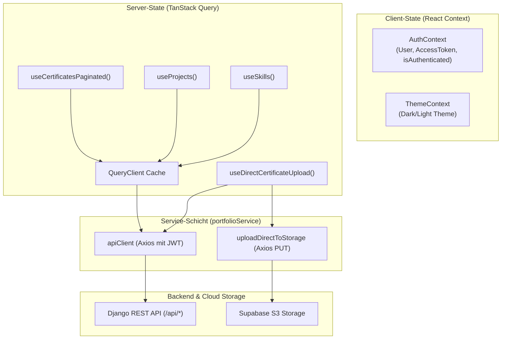

# Frontend Architektur & Dokumentation

Diese Dokumentation beschreibt die Architektur, den Komponentenaufbau, das State-Management, das Code-Splitting und die Authentifizierungsmechanismen der React-SPA (`frontend/`).

---

## 1. Übersicht & Tech Stack

Das Frontend ist eine moderne Single Page Application (SPA), optimiert für Performance, Barrierefreiheit (a11y) und Typsicherheit.

| Technologie | Version / Tooling | Zweck |
|---|---|---|
| **Framework** | React 19 + TypeScript | UI-Komponenten und Typsicherheit |
| **Build-Tool** | Vite 8 + Rolldown | Dev-Server & optimiertes Code-Splitting via `manualChunks` |
| **Styling** | Tailwind CSS v4 (`@tailwindcss/vite`) | Utility-first Designsystem ohne Build-Overhead |
| **Server-State** | TanStack Query v5 (`@tanstack/react-query`) | Asynchrones Caching, Hintergrund-Sync & Deduplizierung |
| **HTTP-Client** | Axios (`axios`) | Request-/Response-Interceptors & automatischer Token-Refresh |
| **Routing** | React Router v7 (`react-router-dom`) | Client-Side-Routing mit `React.lazy` für geschützte Dashboard-Routen |
| **Icons** | Lucide React | Einheitliche SVG-Icons |
| **Animationen** | Framer Motion | Sanfte Übergänge und interaktive Effekte |
| **Testing & Linting** | Vitest + React Testing Library + Oxlint | Schnelle Unit-/Komponententests und ultraschnelles Linting |

---

## 2. Verzeichnisstruktur

```
frontend/src/
├── api/
│   ├── client.ts                 # Axios Instanz mit JWT-Injektion & 401-Refresh-Queue
│   └── client.test.ts            # Tests für Interceptors und Queue-Verhalten
├── components/
│   ├── dashboard/                # Admin-Komponenten
│   │   ├── CertificateEditModal.tsx   # Review-Drawer & On-Demand OCR Metadaten
│   │   ├── CertificateManager.tsx     # Paginierte Zertifikatsliste & Filter
│   │   ├── ConfirmModal.tsx           # Sicherheitsdialog für Löschaktionen
│   │   ├── PendingCertificateManager.tsx # Inbox-Review & Freigabe
│   │   ├── ProjectManager.tsx         # Projekt-Verwaltung
│   │   ├── SkillManager.tsx           # Skill-Verwaltung
│   │   ├── TimelineManager.tsx        # Werdegangs-Verwaltung
│   │   └── UploadCertificateModal.tsx # Direct-to-Storage S3 Upload-Dialog
│   ├── CertificatesSection.tsx   # Startseiten-Zertifikate mit Track-Chips
│   ├── ColdStartBanner.tsx       # Transparenter Ladebalken bei Render-Kaltstart
│   ├── ErrorBoundary.tsx         # Globaler React ErrorBoundary für Crash-Resilienz
│   ├── HeroSearch.tsx            # Interaktive Suche im Hero-Bereich
│   ├── Navbar.tsx / Footer.tsx   # Layout-Komponenten
│   ├── ProjectsSection.tsx       # Projektübersicht mit Skills
│   ├── SectionEmptyState.tsx     # Benutzerfreundliche Leeransicht bei Filtern
│   ├── SkillsSection.tsx         # Skill-Kategorien & Fortschrittsbalken
│   ├── ThemeToggle.tsx           # Dark-/Light-Mode Umschalter
│   └── TimelineSection.tsx       # Werdegang & Karriere-Stationen
├── context/
│   ├── AuthContext.tsx           # Globaler Auth-Status (Token-Persistenz, Login/Logout)
│   └── ThemeContext.tsx          # Dark-/Light-Mode State
├── hooks/
│   ├── useColdStartTracker.ts    # Misst API-Latenzen und meldet Server-Kaltstarts
│   ├── usePortfolio.ts           # TanStack Query Hooks (useCertificatesPaginated, useDirectCertificateUpload, ...)
│   └── usePortfolioSearch.ts     # Client-seitige Volltextsuche und Filterung
├── pages/
│   ├── PortfolioPage.tsx         # Öffentliche Portfolio-Startseite (Home)
│   ├── LoginPage.tsx             # JWT-Login für das Management-Interface (lazy)
│   └── DashboardPage.tsx         # Geschütztes Dashboard mit Review-Drawer (lazy)
├── services/
│   └── portfolioService.ts       # Zentraler Service für API-Calls & direkten S3-Upload
├── types/
│   └── index.ts                  # TypeScript Schnittstellen (Certificate, Project, Track, User, ...)
├── App.tsx                       # Router-Konfiguration, Suspense & Provider-Setup
└── main.tsx                      # Einstiegspunkt (QueryClientProvider, DOM Mounting)
```

---

## 3. State Management & Datenfluss

Gemäß [ADR-004](adrs/004-state-management-frontend.md) trennt die Anwendung strikt zwischen **Server-State** und **Client-State**:



### 3.1 Server-State mit TanStack Query (`usePortfolio.ts`)
- **Query Keys (`portfolioKeys`)**: Strukturierte, hierarchische Keys zur gezielten Cache-Invalidierung:
  - `portfolioKeys.certificates()` $\rightarrow$ `['portfolio', 'certificates']`
  - `portfolioKeys.projects()` $\rightarrow$ `['portfolio', 'projects']`
  - `portfolioKeys.skills()` $\rightarrow$ `['portfolio', 'skills']`
  - `portfolioKeys.tracks()` $\rightarrow$ `['portfolio', 'tracks']`
  - `portfolioKeys.pendingCertificates()` $\rightarrow$ `['portfolio', 'pendingCertificates']`
- **Cache-Invalidierung bei Mutationen**: Schreibende Aktionen invalidieren nach erfolgreicher Antwort gezielt die betroffenen Query-Keys (z. B. `queryClient.invalidateQueries({ queryKey: portfolioKeys.certificates() })`), um aktuelle Daten vom Server zu beziehen.
- **Stale Time**: Auf 5 Minuten (bzw. 1-2 Minuten bei paginierten Admin-Listen) konfiguriert, um Hintergrundanfragen bei statischen Portfolio-Inhalten zu minimieren.

### 3.2 Client-State mit React Context (`AuthContext.tsx`)
- Verwaltet die Authentifizierungsinformationen (`user`, `accessToken`, `refreshToken`) im `localStorage`.
- Hört auf das benutzerdefinierte Event `window.dispatchEvent(new Event('auth:unauthorized'))`.
- Sobald ein Token-Refresh scheitert oder ungültig wird, setzt der Context den Zustand zurück und leitet den Benutzer kontrolliert auf `/login` um.

---

## 4. API-Client & JWT Refresh-Zyklus (`client.ts`)

Der Axios-Client handhabt den gesamten Token-Lifecycle transparent:

1. **Request Interceptor**:
   - Liest `access_token` aus dem `localStorage`.
   - Setzt `Authorization: Bearer <token>` im HTTP-Header.
2. **Response Interceptor (Concurrency-Safe Token Refresh)**:
   - Fängt HTTP-Status `401 Unauthorized` ab.
   - Falls bereits ein Refresh-Request läuft (`isRefreshing = true`), werden parallele Folge-Requests in eine Warteschlange (`failedQueue`) eingereiht.
   - Ruft `POST /api/auth/jwt/refresh/` mit dem `refresh_token` auf.
   - Nach erfolgreichem Refresh wird die Warteschlange abgearbeitet und alle pausierten Anfragen wiederholt.
   - Schlägt der Refresh fehl, werden Tokens aus dem `localStorage` gelöscht und das globale Event `auth:unauthorized` gefeuert.

---

## 5. Code-Splitting & Bundle-Optimierung (Vite / Rolldown)

Gemäß **User Story 7.2** ist das Frontend für minimale Ladezeiten der öffentlichen Startseite optimiert:

- **Route-basiertes Lazy Loading (`App.tsx`)**:
  ```tsx
  const LoginPage = lazy(() => import('./pages/LoginPage').then((m) => ({ default: m.LoginPage })));
  const DashboardPage = lazy(() => import('./pages/DashboardPage').then((m) => ({ default: m.DashboardPage })));
  ```
  Besucher der Startseite (`/`) laden weder den Code des Login-Dialogs noch die umfangreichen Admin-Komponenten (Review-Drawer, Upload-Modal, Manager).
- **Vite Chunking (`vite.config.ts`)**:
  Über `manualChunks` werden Third-Party-Bibliotheken in dedizierte Vendor-Bundles ausgelagert:
  - `vendor-react`: `react`, `react-dom`, `react-router-dom`
  - `vendor-query`: `@tanstack/react-query`
  - `vendor-motion`: `framer-motion`
  - `vendor-icons`: `lucide-react`
  Der Haupt-Initial-Chunk unterschreitet damit deutlich die 100-kB-Marke (~77 kB).

---

## 6. Cold-Start-UX (Render Free-Tier)

Gemäß **User Story 6.2** fängt das Frontend Kaltstarts des Render-Containers transparent ab:

- [`useColdStartTracker`](../frontend/src/hooks/useColdStartTracker.ts) überwacht API-Latenzen über Axios-Interceptors.
- Überschreitet ein Request eine Dauer von 2000 ms, schaltet [`ColdStartBanner`](../frontend/src/components/ColdStartBanner.tsx) eine dezente Benachrichtigung mit animiertem Ladebalken ein: *„Server wacht auf (Render Free-Tier)...“*.
- Sobald die Antwort eintrifft, blendet sich der Banner sanft aus. Bei anhaltendem Timeout (> 30s) erscheint ein Retry-Button.

---

## 7. Direct-to-Storage Upload (Supabase S3)

Gemäß **User Story 10.1** können Zertifikate ohne Belastung des Render-Containers hochgeladen werden:

1. **Presigned URL anfordern**: [`portfolioService.getPresignedUploadUrl(filename, type)`](../frontend/src/services/portfolioService.ts) ruft `POST /api/certificates/presigned_upload/` auf.
2. **Direkter Upload zu S3**: [`portfolioService.uploadDirectToStorage(url, file, headers)`](../frontend/src/services/portfolioService.ts) sendet die Datei per `PUT` direkt an Supabase S3 – bewusst ohne Django-Bearer-Header, um Signatur-Konflikte zu vermeiden.
3. **Zertifikat anlegen**: Der generierte `storage_key` wird per `POST /api/certificates/` an Django gemeldet.

Kapselung erfolgt über den React-Query-Hook [`useDirectCertificateUpload`](../frontend/src/hooks/usePortfolio.ts) und die Komponente [`UploadCertificateModal`](../frontend/src/components/dashboard/UploadCertificateModal.tsx).

---

## 8. Styling mit Tailwind CSS v4

- Tailwind CSS v4 wird über das offizielle Vite-Plugin `@tailwindcss/vite` direkt im CSS eingebunden:
  ```css
  @import "tailwindcss";
  ```
- **Dark Mode**: Unterstützt über CSS-Klassen (`class="dark"` am `<html>`-Element), gesteuert via `ThemeContext`.
- **Responsive Design**: Mobile-First Ansatz mit Breakpoints (`sm:`, `md:`, `lg:`, `xl:`).

---

## 9. Testing-Strategie & Qualitätssicherung

```bash
cd frontend

# Tests ausführen (Vitest)
npm run test

# Linter prüfen (Oxlint)
npm run lint

# TypeScript-Kompilierung & Production-Build
npm run build
```

- **Vitest**: Ausführung aller 51 Komponenten-, Hook- und Interceptor-Tests in isolierten Umgebungen.
- **React Testing Library**: Nutzerzentrierte Tests basierend auf Accessibility-Rollen (`getByRole`, `findByText`).
- **Oxlint**: Extrem schneller Rust-basierter Linter zur Einhaltung von Code-Standards.
