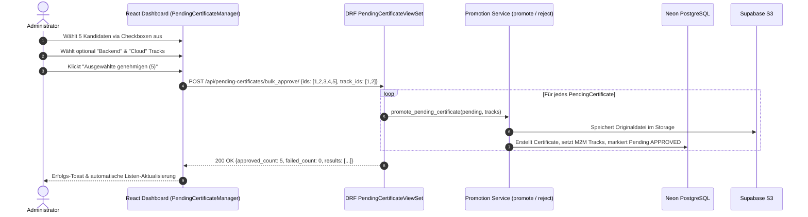

# Spezifikation & Blueprint: User Story 14.2

## Thema: Bulk-Approve und Bulk-Reject im Django-Admin und React-Dashboard

- **Epic:** Epic 14 (Inbox-Automatisierung, Duplikatsprüfung & Batch-Processing)
- **Status:** Abgeschlossen (Done)
- **Priorität:** P1 (Hoch)
- **Zielgruppe / Beteiligte:** Django-Experte, Frontend-Developer, QA-Tester, DevOps

---

## 1. Fachlicher Kontext & Problemstellung

Im Rahmen von **User Story 13.2** wurde die Einzelprüfung von `PendingCertificate`-Datensätzen mit Dokumentenvorschau ("Show File") sowohl im Django-Admin als auch im React-Dashboard eingeführt. 

Wenn der Administrator jedoch automatisiert größere Zertifikatsstapel (z. B. 20–50 PDF-Dateien aus `CERTIFICATES_PATH` via `scan_inbox`) importiert hat, ist die Einzelabnahme jedes Kandidaten über separate Klicks und Modale zeitaufwendig und ineffizient.

### Ziele von US 14.2:
1. **Effiziente Massenabnahme:** Der Administrator soll mehrere oder alle ausstehenden Zertifikate mit einer einzigen Aktion freigeben ("Bulk-Approve") oder ablehnen ("Bulk-Reject") können.
2. **Track-Konsistenz:** Bei der Massenfreigabe können optional Standard-Tracks (`track_ids`) zugewiesen werden. Liegen keine expliziten Tracks vor, greift das System auf die von der Heuristik erkannten `suggested_tracks` des jeweiligen Datensatzes zurück.
3. **Plattformübergreifende Konsistenz:** Die Funktionalität muss sowohl über die REST-API im React-Dashboard als auch nativ im Django-Admin (`admin.action`) zur Verfügung stehen.
4. **Fehlertoleranz & Teilerfolg:** Tritt bei einer einzelnen Datei ein Fehler auf (z. B. Datei physisch nicht mehr auffindbar), darf nicht der gesamte Batch abbrechen; stattdessen werden Teilerfolge transparent mit detaillierter Fehleraufstellung quittiert.

---

## 2. Architektur & Datenfluss



---

## 3. API-Spezifikation (REST-Endpunkte)

### 3.1 `POST /api/pending-certificates/bulk_approve/`
- **Berechtigung:** `IsAdminUser` (Staff-User / JWT)
- **Request Body:**
  ```json
  {
    "ids": [10, 11, 12],
    "track_ids": [1, 3]
  }
  ```
  - `ids` (Pflicht): Array von Integers (IDs von `PendingCertificate`). Min. 1 Element.
  - `track_ids` (Optional): Array von Integers (IDs von `Track`). Falls weggelassen oder leer, werden die individuellen `suggested_tracks` des jeweiligen `PendingCertificate` verwendet.

- **Response `200 OK` (Erfolg oder Teilerfolg):**
  ```json
  {
    "approved_count": 3,
    "failed_count": 0,
    "results": [
      {
        "id": 10,
        "certificate_id": 105,
        "status": "approved",
        "title": "AWS Certified Solutions Architect"
      },
      {
        "id": 11,
        "certificate_id": 106,
        "status": "approved",
        "title": "Professional Scrum Master I"
      },
      {
        "id": 12,
        "certificate_id": 107,
        "status": "approved",
        "title": "Google Cloud Associate Cloud Engineer"
      }
    ],
    "errors": []
  }
  ```

- **Response `400 Bad Request` (Validierungsfehler):**
  - Leere oder fehlende `ids`: `{"detail": "Mindestens eine ID muss angegeben werden."}`
  - Ungültige `track_ids`: `{"detail": "Track 999 nicht gefunden."}`

---

### 3.2 `POST /api/pending-certificates/bulk_reject/`
- **Berechtigung:** `IsAdminUser` (Staff-User / JWT)
- **Request Body:**
  ```json
  {
    "ids": [14, 15]
  }
  ```

- **Response `200 OK`:**
  ```json
  {
    "rejected_count": 2,
    "failed_count": 0,
    "results": [
      {"id": 14, "status": "rejected"},
      {"id": 15, "status": "rejected"}
    ],
    "errors": []
  }
  ```

---

## 4. User Story & Akzeptanzkriterien

### User Story 14.2: Bulk-Approve und Bulk-Reject im Django-Admin und React-Dashboard

> **Als** Administrator  
> **möchte ich** mehrere ausstehende Zertifikate gleichzeitig per Sammelaktion freigeben oder ablehnen können,  
> **damit** ich nach automatisierten Datei-Imports große Mengen an Zertifikaten schnell, komfortabel und konsistent abarbeiten kann.

---

### Akzeptanzkriterien (Acceptance Criteria)

- [x] **Szenario 1 (REST-API `bulk_approve` Erfolgsfall):**
  - **Given** drei `PendingCertificate`-Datensätze mit Status `pending`
  - **When** ein Administrator `POST /api/pending-certificates/bulk_approve/` mit `ids: [1, 2, 3]` und `track_ids: [4]` sendet
  - **Then** antwortet die API mit Statuscode `200 OK`
  - **And** alle drei Datensätze besitzen nun den Status `approved`
  - **And** für jedes Dokument existiert ein zugeordnetes `Certificate`-Objekt mit verknüpftem Track 4 und `is_published=False`.

- [x] **Szenario 2 (REST-API `bulk_approve` Fallback auf `suggested_tracks`):**
  - **Given** ein ausstehendes Zertifikat besitzt heuristisch vorgeschlagene Tracks (`suggested_tracks: [2, 5]`)
  - **When** `POST /api/pending-certificates/bulk_approve/` ohne `track_ids` aufgerufen wird
  - **Then** erhält das neu angelegte `Certificate` die Tracks 2 und 5.

- [x] **Szenario 3 (REST-API `bulk_approve` Teilerfolg & Fehlerabfang):**
  - **Given** ein Batch von zwei IDs, wovon eine Datei lokal nicht mehr existiert
  - **When** `bulk_approve` ausgeführt wird
  - **Then** liefert die API `200 OK` mit `approved_count: 1`, `failed_count: 1`
  - **And** das Array `errors` enthält Details zur fehlgeschlagenen Datei, während die valide Datei erfolgreich transferiert wurde.

- [x] **Szenario 4 (REST-API `bulk_reject`):**
  - **Given** mehrere ausstehende Zertifikate mit Status `pending`
  - **When** `POST /api/pending-certificates/bulk_reject/` mit deren IDs aufgerufen wird
  - **Then** werden die Datensätze auf Status `rejected` gesetzt und `rejected_count` zurückgegeben.

- [x] **Szenario 5 (Django-Admin Massenaktionen):**
  - **Given** die Changelist von `PendingCertificateAdmin`
  - **When** der Administrator mehrere Zeilen markiert
  - **Then** stehen im Aktions-Dropdown zwei Aktionen zur Verfügung:
    1. *„Ausgewählte Zertifikate freigeben und übertragen“* (`promote_selected`)
    2. *„Ausgewählte Zertifikate ablehnen“* (`reject_selected`)
  - **And** die Ausführung quittiert die Anzahl erfolgreicher und fehlgeschlagener Übertragungen via Django Messages (`messages.SUCCESS` / `messages.ERROR`).

- [x] **Szenario 6 (React-Dashboard Interaktive Massenauswahl):**
  - **Given** `PendingCertificateManager.tsx` im Admin-Dashboard
  - **When** ausstehende Kandidaten gelistet werden
  - **Then** besitzt jede Zeile/Karte eine Checkbox und die Tabellen-Kopfzeile eine „Alle auswählen“-Checkbox
  - **And** bei Auswahl von mindestens einem Element blendet sich eine Floating Action Bar ein mit:
    - Zähler der markierten Zertifikate (*„X Zertifikate ausgewählt“*)
    - Track-Multi-Select Dropdown zur optionalen gemeinsamen Track-Zuweisung
    - Grüner Button *„Ausgewählte genehmigen“* mit Lade-Indikator
    - Roter Button *„Ausgewählte ablehnen“* mit Sicherheitsabfrage
  - **And** nach erfolgreicher Mutation invalidiert TanStack Query die Keys `['pending-certificates']` und `['certificates']` automatisch.

- [x] **Szenario 7 (Automatisierte Testabdeckung):**
  - **Given** die neuen API-Endpunkte und Frontend-Komponenten
  - **When** Pytest im Backend (`uv run pytest portfolio/tests/test_pending_bulk_operations.py`) und Vitest im Frontend (`npm run test:run`) ausgeführt werden
  - **Then** sind alle Szenarien (Erfolg, Validierungsfehler, Teilerfolge, Hooks) abgedeckt und die Backend-Coverage bleibt $\ge 95\%$.

---

## 5. Detaillierte Implementierungs-Schritte

### Schritt 1: Backend Service- & View-Erweiterung (Django-Experte)
1. **`portfolio/views.py` (`PendingCertificateViewSet`):**
   - Hinzufügen der `@action(detail=False, methods=["post"])` `bulk_approve`.
   - Hinzufügen der `@action(detail=False, methods=["post"])` `bulk_reject`.
   - Wiederverwendung von `_resolve_tracks()` und `promote_pending_certificate()` bzw. `reject_pending_certificate()`.
2. **`portfolio/admin.py` (`PendingCertificateAdmin`):**
   - Registrierung von `reject_selected` in `actions = ("promote_selected", "reject_selected")`.
   - Implementierung der Massenablehnung mit Statusmeldung.
3. **Tests (`portfolio/tests/test_pending_bulk_operations.py`):**
   - Tests für Massenfreigabe (mit und ohne Tracks), Massenablehnung, leere Payload und Teilerfolg.

---

### Schritt 2: Frontend Client & Dashboard (Frontend-Developer)
1. **`frontend/src/api/client.ts` / `usePortfolio.ts`:**
   - Hinzufügen von `bulkApprovePendingCertificates(payload: { ids: number[]; track_ids?: number[] })`
   - Hinzufügen von `bulkRejectPendingCertificates(ids: number[])`
   - Hooks: `useBulkApprovePendingCertificates()` und `useBulkRejectPendingCertificates()`.
2. **`frontend/src/components/dashboard/PendingCertificateManager.tsx`:**
   - Zustand `selectedIds: Set<number>`.
   - Toggle-Handler für Einzelauswahl und „Select All“.
   - Sticky Action Bar am unteren Bildschirmrand (`fixed bottom-6` oder Tabellen-Header) mit Track-Auswahl und Aktions-Buttons.
3. **Vitest Tests (`PendingCertificateManager.test.tsx`):**
   - Überprüfung des Checkbox-Verhaltens, der Button-Aktivierung und der Mutationsaufrufe.
