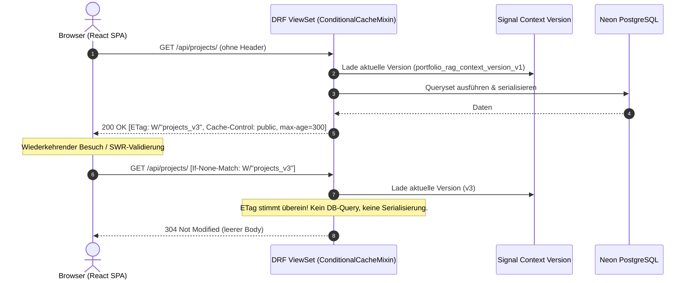

# Technisches Implementierungs-Blueprint: US 15.1 – HTTP Conditional Caching (ETag & 304 Not Modified)

**Epic**: Epic 15 – Public Performance, HTTP-Caching & Core Web Vitals  
**Story-ID**: US 15.1  
**Verantwortliche Rolle**: Django-Experte (Backend)  
**Reviewer / QA**: Technical Product Manager / QA-Tester  
**Status**: Bereit zur Implementierung (Ready for Implementation)  

---

## 1. User Story

> **Als** Portfolio-Besucher und Betreiber  
> **möchte ich**, dass öffentliche Lese-Endpunkte (`/api/projects/`, `/api/tracks/`, `/api/skills/`, `/api/certificates/`) standardmäßige HTTP-Caching-Header (`ETag`, `Cache-Control`, `304 Not Modified`) unterstützen,  
> **damit** wiederkehrende Besuche blitzschnell geladen werden und unnötige Datenbankabfragen auf Neon PostgreSQL sowie Serializer-Berechnungen vermieden werden.

---

## 2. Akzeptanzkriterien (BDD-Format)

### Szenario 1: ETag-Generierung auf Basis der Signal-Cache-Version
- **Given** eine Leseanfrage (`GET` oder `HEAD`) an einen öffentlichen Endpunkt (`/api/projects/`, `/api/tracks/`, `/api/skills/`, `/api/certificates/`)
- **When** die Antwort erzeugt wird
- **Then** enthält die Response einen `ETag`-Header im Format `W/"<resource_name>_v<version>"`
- **And** die Version basiert atomar auf dem globalen Cache-Key `portfolio_rag_context_version_v1`
- **And** der Header `Cache-Control: public, max-age=300, stale-while-revalidate=60` ist für unauthentifizierte Anfragen gesetzt.

### Szenario 2: 304 Not Modified bei unveränderten Daten
- **Given** ein Client sendet den Request mit dem Header `If-None-Match: W/"<resource_name>_v<version>"`
- **When** der ETag mit dem aktuellen Server-Zustand übereinstimmt
- **Then** antwortet Django unmittelbar mit Statuscode `304 Not Modified`
- **And** der Response-Body ist komplett leer
- **And** es werden weder die Model-Serialisierung noch teure SQL-Abfragen auf Neon PostgreSQL ausgeführt.

### Szenario 3: ETag-Invalidierung bei Datenmutationen
- **Given** ein gecachtes Queryset mit Version $V_1$
- **When** ein Administrator ein Projekt, Zertifikat, Skill, Track oder Provider anlegt, ändert oder löscht (`post_save`, `post_delete`)
- **Then** inkrementiert der Signal-Handler in `portfolio/signals.py` die Version atomar auf $V_2$
- **And** ein nachfolgender Request mit `If-None-Match: W/"<resource_name>_v1"` liefert wieder Statuscode `200 OK` mit dem neuen ETag `W/"<resource_name>_v2"` und dem aktualisierten Payload.

### Szenario 4: Caching-Bypass für authentifizierte Dashboard-Zugriffe
- **Given** ein authentifizierter Administrator (`request.user.is_authenticated == True`) sendet einen Request mit Bearer-Token
- **When** der View ausgeführt wird
- **Then** wird `Cache-Control: no-cache, private` gesetzt
- **And** der Administrator erhält stets die frischen Daten ohne Browser-Cache-Interferenz.

---

## 3. Architektur & Datenfluss



---

## 4. Technische Implementierungs-Vorgaben für den Django-Experten

### 4.1 Schritt 1: Signal-Erweiterung in `backend/portfolio/signals.py`
Die bestehende Signal-Funktion `invalidate_rag_cache` muss auf die Modelle `Provider` und `Track` erweitert werden:
```python
# Registrierung der Signale für Provider und Track
@receiver([post_save, post_delete], sender=Provider)
@receiver([post_save, post_delete], sender=Track)
def invalidate_entity_cache(sender, instance, **kwargs):
    # Inkrementiert atomar portfolio_rag_context_version_v1
    # Löscht portfolio_rag_grounding_context
```

### 4.2 Schritt 2: `ConditionalCacheMixin` in `backend/portfolio/views.py`
Das Mixin fängt die Methode `initial(request, *args, **kwargs)` oder `list()` vor der Serialisierung ab:
- **ETag-Berechnung**:
  ```python
  version = cache.get("portfolio_rag_context_version_v1", 1)
  etag = f'W/"{self.basename or self.model_name}_v{version}"'
  ```
- **304 Evaluation**:
  - Prüfe `request.META.get("HTTP_IF_NONE_MATCH")`.
  - Wenn `if_none_match == etag` und Request-Methode in `("GET", "HEAD")` und `not request.user.is_authenticated`:
    - Gebe sofort `HttpResponseNotModified()` zurück.
- **Header-Injektion**:
  - Response mit `ETag` versehen.
  - `Cache-Control` konditional setzen (`public, max-age=300, stale-while-revalidate=60` vs. `no-cache, private`).

### 4.3 Schritt 3: Einbindung in ViewSets
Das Mixin muss den folgenden öffentlichen ViewSets vorangestellt werden:
- `ProjectViewSet`
- `CertificateViewSet`
- `SkillViewSet`
- `TrackViewSet`

---

## 5. Testplan & Definition of Done (DoD)

Der QA-Tester / Django-Experte erstellt die Testsuite [`backend/portfolio/tests/test_caching.py`](file:///d:/dev/portfolio_project/backend/portfolio/tests/test_caching.py) mit folgenden Testfällen:
1. `test_etag_header_present_on_public_list_views`: Verifiziert `ETag`-Header auf `/api/projects/`, `/api/tracks/`, `/api/skills/`, `/api/certificates/`.
2. `test_if_none_match_returns_304`: Zweiter Request mit passendem ETag liefert `304 Not Modified` mit leerem Inhalt.
3. `test_model_save_increments_version_and_invalidates_etag`: Änderung an einem Projekt oder Track ändert den ETag; alter ETag liefert `200 OK`.
4. `test_authenticated_requests_receive_no_cache`: Request mit authentifiziertem Staff-User liefert `Cache-Control: no-cache, private`.
5. `test_provider_and_track_signals_trigger_invalidation`: `Provider.objects.create(...)` und `Track.objects.create(...)` inkrementieren die Cache-Version.
6. `test_coverage_threshold`: Gesamtabdeckung des Backends bleibt bei $\ge 95\%$.

---

## 6. Sicherheits- und Schutzregeln
- **Quellordner-Schutz**: `CERTIFICATES_PATH` in `.env` ist **STRIKT READ-ONLY** und wird durch diese Änderung nicht berührt.
- **Commit-Format**: Conventional Commit, Header $\le 72$ Zeichen, z. B.:
  ```text
  feat(backend): implement conditional cache mixin and etags for public apis
  ```
