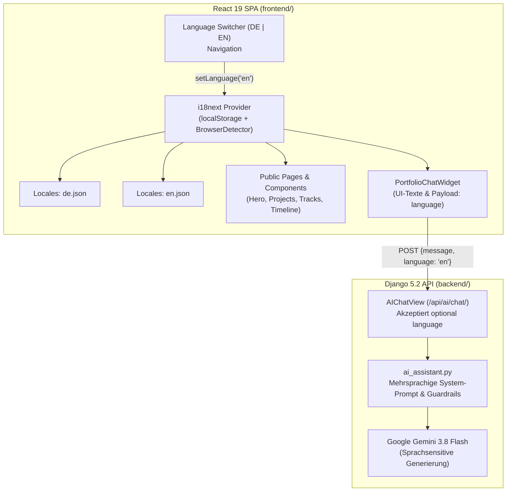

# Spezifikation & Blueprint: User Story 16.1

## Thema: Zweisprachiges Portfolio (DE / EN) & Mehrsprachiger RAG-Copilot

- **Epic:** Epic 16 (Internationalisierung (i18n), Accessibility & Theme Polish)
- **Status:** Bereit zur Umsetzung (Ready)
- **Priorität:** P2 (Mittel)
- **Zielgruppe / Beteiligte:** Frontend-Developer, Django-Experte, QA-Tester

---

## 1. Fachlicher Kontext & Problemstellung

Das Portfolio richtet sich sowohl an den deutschsprachigen Arbeitsmarkt als auch an internationale Recruiter, globale Tech-Unternehmen und Open-Source-Collaborators.

Bisher sind alle statischen Benutzeroberflächen-Texte im React-Frontend (`frontend/src/`) ausschließlich auf Deutsch hinterlegt. Zwar besitzt der Google-Gemini-Copilot bereits eine Heuristik zur Erkennung der Fragesprache, jedoch sind alle Standard-Systemmeldungen, Guardrail-Abweisungen und Fehlertexte hart auf Deutsch codiert.

### Ziele von US 16.1:
1. **Frontend-Lokalisierung (i18n):** Nahtlose Umschaltung zwischen Deutsch (`de`) und Englisch (`en`) über einen interaktiven Sprach-Switch in der Navigation.
2. **Persistenz & Fallback:** Die gewählte Sprache wird im `localStorage` gespeichert; Neubesucher erhalten automatisch die bevorzugte Browser-Sprache (`navigator.language`).
3. **Mehrsprachiger RAG-Copilot:** Der Copilot antwortet in perfektem Englisch oder Deutsch. UI-Texte des Chat-Widgets sowie defensive System-Guardrails (z. B. bei Circuit-Breaker oder Längenbeschränkung) werden in der aktiven Nutzersprache ausgeliefert.
4. **Strikte Fakten-Bindung:** Trotz Übersetzung ins Englische bleiben alle Fakten, Technologien, Projekt-IDs und Deep-Link-Quell-Badges (`#project-<id>`, `#cert-<id>`) 100 % intakt.

---

## 2. Architektur & Komponenten-Design



---

## 3. Akzeptanzkriterien (BDD-Format)

### User Story 16.1: Zweisprachiges Portfolio (DE / EN) & Mehrsprachiger RAG-Copilot

> **Als** internationaler Recruiter oder Besucher  
> **möchte ich** das Portfolio und den RAG-Copiloten nahtlos auf Englisch umschalten können,  
> **damit** ich Qualifikationen, Projektdetails und Werdegang in meiner bevorzugten Sprache einsehen und interaktiv erfragen kann.

---

### Akzeptanzkriterien (Acceptance Criteria)

- [ ] **Szenario 1 (Frontend Sprachumschalter in der Navigation):**
  - **Given** die Navigationsleiste auf der Startseite
  - **When** der Besucher auf den Language-Toggle (`DE` / `EN`) klickt
  - **Then** schalten alle statischen Texte (Navigation, Hero-Headline, Sektionstitel, Filter-Labels, Buttons, Footer) ohne Neuladen der Seite sofort um
  - **And** das HTML-Attribut `<html lang="...">` wird auf `en` bzw. `de` synchronisiert
  - **And** die Auswahl wird im `localStorage` unter `portfolio_language` persistiert.

- [ ] **Szenario 2 (Browser-Spracherkennung bei Erstbesuch):**
  - **Given** ein Erstbesucher ohne gespeicherte `portfolio_language`
  - **When** sein Browser `navigator.language` mit englischem Prefix (`en-US`, `en-GB`, `en`) sendet
  - **Then** startet die Anwendung automatisch auf Englisch (`en`)
  - **And** bei allen anderen Sprachen greift der Fallback auf Deutsch (`de`).

- [ ] **Szenario 3 (Mehrsprachiger RAG-Copilot mit englischer Anfrage):**
  - **Given** eine englischsprachige Frage an `/api/ai/chat/` (z. B. *"What experience does Dominik have with Cloud deployments?"*)
  - **When** der RAG-Copilot die Antwort generiert
  - **Then** antwortet der Assistent in professionellem, natürlichem Englisch
  - **And** alle erwähnten Fakten, Rollen und Fähigkeiten basieren strikt auf dem Vektorkontext.

- [ ] **Szenario 4 (Copilot Guardrail-Meldungen in der Nutzersprache):**
  - **Given** ein Besucher mit aktiver Sprache `en`
  - **When** eine Anfrage das Längenlimit überschreitet oder der Circuit-Breaker greift
  - **Then** antwortet die API mit englischen Systemmeldungen (z. B. *"Please keep your question shorter (maximum 500 characters)."* bzw. *"AI token limit reached."*).

- [ ] **Szenario 5 (Robuste Deep-Linking Badges in beiden Sprachen):**
  - **Given** eine englischsprachige Antwort des Copiloten
  - **When** Quellen wie `[Project: 1]` oder `[Certificate: 5]` referenziert werden
  - **Then** erkennt das Frontend die Quell-Tags zuverlässig und rendert die interaktiven Badges mit unveränderter Scroll- und Glow-Funktionalität.

- [ ] **Szenario 6 (Automatisierte Testabdeckung):**
  - **Given** die neuen Lokalisierungs-Dateien und Chat-Erweiterungen
  - **When** die Frontend-Tests (`npm run test:run`) und Backend-Tests (`uv run pytest portfolio/tests/test_ai_chat.py`) ausgeführt werden
  - **Then** verifizieren Unit-Tests den Sprachwechsel, die Übersetzung und die mehrsprachigen Copilot-Responses.

---

## 4. Detaillierter Implementierungsplan

### Phase 1: Frontend Internationalisierung (`frontend/`)

1. **Abhängigkeiten installieren:**
   ```bash
   cd frontend
   npm install i18next react-i18next i18next-browser-languagedetector
   ```

2. **Lokalisierungsdateien anlegen:**
   - `frontend/src/locales/de.json`:
     - Menü, Hero ("Fullstack & Cloud Engineer"), Projektkarten, Filter, Badges, Footer, Chat-Widget.
   - `frontend/src/locales/en.json`:
     - Vollständige englische Übersetzung aller Keys.

3. **i18n-Konfiguration (`frontend/src/i18n.ts`):**
   ```typescript
   import i18n from 'i18next';
   import { initReactI18next } from 'react-i18next';
   import LanguageDetector from 'i18next-browser-languagedetector';
   import de from './locales/de.json';
   import en from './locales/en.json';

   i18n
     .use(LanguageDetector)
     .use(initReactI18next)
     .init({
       resources: { de: { translation: de }, en: { translation: en } },
       fallbackLng: 'de',
       interpolation: { escapeValue: false },
       detection: {
         order: ['localStorage', 'navigator'],
         lookupLocalStorage: 'portfolio_language',
       },
     });

   export default i18n;
   ```

4. **LanguageSwitcher-Komponente:**
   - Schlanker Toggle-Button in `frontend/src/components/common/LanguageSwitcher.tsx` (z. B. `DE | EN` mit Pill-Highlight).

---

### Phase 2: Backend & KI-Copilot Anpassung (`backend/`)

1. **Request-Payload erweitern (`AIChatView` in `portfolio/views.py`):**
   - Auslesen von `language = request.data.get("language", "de")`.
   - Übergabe an `answer_portfolio_query(user_message, history, language=language)`.

2. **Lokalisierte Systemtexte in `ai_assistant.py`:**
   - Bereitstellung von Guardrail-Meldungen als Wörterbuch:
     ```python
     GUARDRAIL_MESSAGES = {
         "de": {
             "too_long": "Bitte formuliere deine Frage etwas kürzer (maximal 500 Zeichen).",
             "injection": "Ich bin Dominiks Portfolio-Assistent und beantworte ausschließlich Fragen zu seinen Projekten, Skills und Zertifikaten.",
             "circuit_breaker": "Das kostenfreie Token-Limit für den KI-Assistenten wurde erreicht...",
         },
         "en": {
             "too_long": "Please keep your question shorter (maximum 500 characters).",
             "injection": "I am Dominik's portfolio assistant and only answer questions about his projects, skills, and certifications.",
             "circuit_breaker": "The free token quota for the AI assistant has been reached...",
         },
     }
     ```

3. **System Instruction Ergänzung:**
   - Instruktion an Gemini 3.8 Flash: *"If language is 'en' or the question is English, respond in clear, professional English while preserving all factual data and source tags."*
