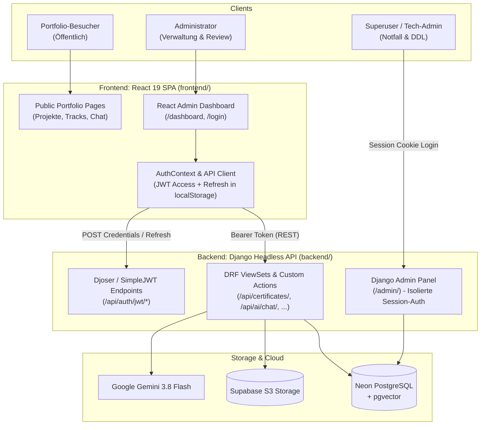

# Spezifikation & Blueprint: User Story 3.2

## Thema: Vollständige Bereinigung historischer Root-Artefakte & Dashboard-Auth-Harmonisierung

- **Epic:** Epic 3 (Repository-Hygiene & Dateistruktur) / Epic 7 (Headless Cleanup)
- **Status:** Bereit zur Umsetzung (Ready)
- **Priorität:** P1 (Hoch)
- **Zielgruppe / Beteiligte:** DevOps, Django-Experte, Frontend-Developer, QA-Tester

---

## 1. Kontext & Problemstellung

Im Zuge der Evolution des Portfolio-Projekts wurde die Codebasis von einem ursprünglichen Django-Monolithen mit serverseitig gerenderten HTML-Templates (`login.html`, `dashboard.html`) in ein modernes Monorepo mit strikter Trennung überführt:
- `backend/`: Django 5.2 Headless REST-API mit DRF, Djoser, SimpleJWT und WhiteNoise.
- `frontend/`: React 19 SPA mit TypeScript, Vite, Tailwind CSS v4 und TanStack Query.

Obwohl in **ADR-006** und **User Story 7.1** beschlossen und umgesetzt wurde, dass Django rein als Headless-JSON-API agiert und keine serverseitigen Dashboard-Templates mehr betreibt, verblieben im Monorepo-Wurzelverzeichnis (`/`) historische Verzeichnisse und Dateien aus der Zeit vor der Migration:
1. `templates/` (mit `login.html`, `dashboard.html`)
2. `core/` (mit veralteter `settings.py` und `urls.py`)
3. `portfolio/` (mit veralteten Models, Views, Serializers und Migrationen)
4. `db.sqlite3` (veraltete lokale SQLite-Datenbank im Root; die aktive Entwicklungsdatenbank liegt in `backend/db.sqlite3`)
5. `portfolio_project.egg-info/`
6. `media/` und `static/` (im Root ungenutzt; aktive Medien liegen in Supabase S3 bzw. `backend/staticfiles/`)
7. `test_s3.py` (Ad-hoc Testskript im Root)

### Negative Auswirkungen der Altlasten:
- **Verwirrung bei Entwicklern und KI-Agenten:** Verwechslung zwischen `core/settings.py` (Root, veraltet) und `backend/core/settings.py` (aktiv).
- **Fehler in CI/CD & Dependabot:** Dependabot und Linter liefen teilweise fälschlicherweise auf dem Root-Verzeichnis an.
- **Unklare Authentifizierungs-Architektur:** Entwickler könnten vermuten, dass serverseitige Django-Views für `/login/` und `/dashboard/` noch aktiv sind, obwohl das React-Dashboard (`frontend/src/pages/DashboardPage.tsx`) die alleinige Management-Oberfläche darstellt.

---

## 2. Zielbild & Harmonisierungs-Architektur

### 2.1 Single-Auth- & Dashboard-Harmonisierung



1. **Dashboard:** Das operative Dashboard existiert **ausschließlich** als React-19-Komponente (`frontend/src/pages/DashboardPage.tsx`) mit modular aufgebauten Managern (`CertificateManager`, `PendingCertificateManager`, `ProjectManager`, `UploadCertificateModal`).
2. **Authentifizierung für die SPA:** Die SPA nutzt zustandsloses **JWT** via Djoser und SimpleJWT (`/api/auth/jwt/create/`, `/api/auth/jwt/refresh/`). Der Access Token wird automatisch per Axios-Interceptor injiziert und bei `401 Unauthorized` nahtlos über den Refresh-Token erneuert.
3. **Django-Admin (`/admin/`):** Bleibt für technische Superuser-Aufgaben (z. B. Notfall-Datenbankkorrekturen, direkte Django-Inspektion) erhalten und nutzt isoliert die native Django-Session-Authentifizierung. Es gibt keine serverseitigen Templates für Besucher oder normale Admin-Workflows außerhalb des `/admin/`-Pfads.
4. **Keine serverseitigen Dashboard-Templates:** Sämtliche HTML-Templates außerhalb von `backend/templates/admin/` und `backend/templates/email/` sind historischer Ballast und werden gelöscht.

---

## 3. User Story & Akzeptanzkriterien

### User Story 3.2: Vollständige Bereinigung historischer Root-Artefakte & Dashboard-Auth-Harmonisierung

> **Als** Fullstack-Entwickler und Maintainer  
> **möchte ich**, dass alle verwaisten Root-Verzeichnisse (`templates/`, `core/`, `portfolio/`, `db.sqlite3`, etc.) rückstandslos aus dem Repository-Wurzelverzeichnis entfernt werden und die Single-Auth-Architektur über das React-Dashboard verbindlich dokumentiert ist,  
> **damit** das Monorepo eine saubere, unmissverständliche Verzeichnisstruktur besitzt, keine falschen Dateien von Lintern oder Dependabot erfasst werden und die Trennung zwischen Headless Backend und React SPA transparent ist.

---

### Akzeptanzkriterien (Acceptance Criteria)

- [ ] **Szenario 1 (Physische Löschung der verwaisten Root-Verzeichnisse):**
  - **Given** das Repository-Wurzelverzeichnis (`/`)
  - **When** die Bereinigung durchgeführt wird
  - **Then** sind folgende Verzeichnisse und Dateien im Root-Verzeichnis gelöscht:
    - `templates/` (enthält veraltetes `login.html` und `dashboard.html`)
    - `core/` (enthält veraltetes `settings.py` und `urls.py`)
    - `portfolio/` (enthält veraltetes App-Modul)
    - `db.sqlite3` (Root-Datenbankdatei)
    - `portfolio_project.egg-info/`
    - `media/` (im Root ungenutzt)
    - `static/` (im Root ungenutzt)
    - `test_s3.py` (Ad-hoc Skript)
    - `.coverage` (Root-Artefakt)

- [ ] **Szenario 2 (Autarkie und Stabilität des aktiven Backends):**
  - **Given** alle Root-Altlasten wurden entfernt
  - **When** im Verzeichnis `backend/` die Befehle `uv run pytest`, `uv run ruff check .` und `uv run mypy .` ausgeführt werden
  - **Then** laufen alle Tests und Checks fehlerfrei durch (Testabdeckung $\ge 95\%$), da das aktive Backend ausschließlich auf `backend/core/` und `backend/portfolio/` zugreift.
  - **And** `backend/core/settings.py` verweist für `TEMPLATES` ausschließlich auf `BASE_DIR / "templates"` (was auf `backend/templates/` zeigt).

- [ ] **Szenario 3 (Frontend Build & Tests):**
  - **Given** alle Root-Altlasten wurden entfernt
  - **When** im Verzeichnis `frontend/` die Befehle `npm run test:run`, `npm run lint` und `npm run build` ausgeführt werden
  - **Then** kompilieren die Tests und der Vite-Production-Build ohne Fehler oder Warnungen.

- [ ] **Szenario 4 (Root-Hygiene & .gitignore Absicherung):**
  - **Given** die `.gitignore` im Monorepo-Root
  - **When** neue Testläufe oder Builds stattfinden
  - **Then** werden temporäre Dateien wie `.coverage`, `db.sqlite3`, `*.egg-info/` und Scratch-Dateien im Root zuverlässig ignoriert.

- [ ] **Szenario 5 (Dokumentations-Konsistenz):**
  - **Given** die Architekturdokumente `docs/architecture.md`, `docs/backlog.md` und `docs/wiki/System-Architecture.md`
  - **When** Entwickler die Dokumentation lesen
  - **Then** ist die Headless Single-Auth Architektur (JWT für React-Dashboard, isolierte Sessions nur für `/admin/`) einheitlich und widerspruchsfrei dokumentiert.

---

## 4. Konkreter Ausführungsplan für den Entwickler / DevOps

### Schritt 1: Git-Status & Arbeitsstand sichern
Vor der Löschung sicherstellen, dass keine ungesicherten Änderungen in den betroffenen Ordnern existieren (die Ordner sind reine Relikte).

### Schritt 2: Verwaiste Root-Dateien löschen
```bash
# Im Monorepo-Wurzelverzeichnis:
rm -rf templates core portfolio portfolio_project.egg-info media static
rm -f db.sqlite3 test_s3.py .coverage
```

### Schritt 3: Backend-Validierung
```bash
cd backend
uv run pytest --cov=portfolio --cov-fail-under=95
uv run ruff check .
uv run mypy .
cd ..
```

### Schritt 4: Frontend-Validierung
```bash
cd frontend
npm run lint
npm run test:run
npm run build
cd ..
```

### Schritt 5: Commit nach Conventional Commits
```bash
git add -A
git commit -m "chore(repo): remove legacy root modules and harmonize auth architecture"
```
