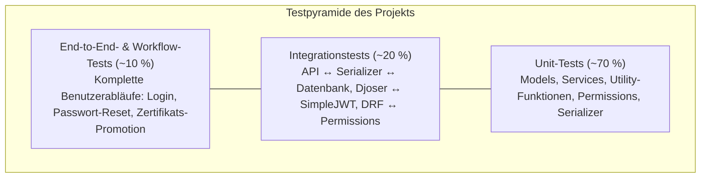

# Teststrategie für das Projekt

Weiterführend: [System-Architektur](architecture.md) · [Deployment & Operations](deployment.md) · [Sicherheitskonzept](SECURITY.md) · [Frontend-Architektur](frontend.md)

---

## 1. Projektkontext & Technologie-Stack

| Schicht / Komponente | Technologie |
|---|---|
| **Backend-Framework** | Django 5.x & Django REST Framework (DRF) |
| **Benutzerverwaltung** | Djoser (`/api/auth/users/`) |
| **Authentifizierung** | SimpleJWT (`/api/auth/jwt/create/`, `/refresh/`, `/verify/`) |
| **Datenbank & Storage** | PostgreSQL (Neon / Supabase) & Supabase S3 Object Storage |
| **Cloud Deployment** | Render (`render.yaml`, Health-Checks, Zero-Downtime) |
| **Test-Runner (Backend)** | `pytest` + `pytest-django` + `pytest-cov` |
| **Test-Runner (Frontend)** | `Vitest` + `React Testing Library` (`jsdom`) |
| **CI/CD** | GitHub Actions ([`.github/workflows/ci.yml`](../.github/workflows/ci.yml)) |

---

## 2. Testziele

Die automatisierte Test-Suite stellt folgende Qualitätsmerkmale bei jedem Commit und Pull Request sicher:

1. **Korrekte JWT-Authentifizierung:** Ausstellung, Signaturprüfung, Ablaufvalidierung und Refresh-Rotation von Token.
2. **Stabile Djoser-Endpunkte:** Benutzerprofil (`/api/auth/users/me/`), Passwort-Reset-Workflows und geschützte Benutzeranlage.
3. **Datenintegrität in PostgreSQL:** Einhaltung von Unique-Constraints, Foreign-Keys und reproduzierbaren Schema-Migrationen.
4. **Sichere Benutzerverwaltung & RBAC:** Schutz administrativer Endpunkte vor unautorisiertem Zugriff (`401 Unauthorized` / `403 Forbidden`).
5. **Funktionierende REST-APIs:** Validierung sämtlicher Serializer, Filter, Paginierungen und Dateiupload-Ströme.
6. **Erfolgreiches Deployment auf Render:** Health-Check-Endpunkte (`/health/` & `/health_check`), Datenbank-Konnektivität und Pflicht-Umgebungsvariablen.
7. **Frühzeitige Regressionserkennung:** Verpflichtendes Coverage-Gate in der CI/CD-Pipeline.

---

## 3. Testpyramide



### 3.1 Unit-Tests (ca. 70 %)

**Fokus:**
- Models (`User`, `Certificate`, `PendingCertificate`, `Project`, `Skill`, `Track`, `TimelineEntry`)
- Services (RAG-Retrieval, Gemini Vision Extractor, Icon-Service, Certificate Promotion, S3 Presigned URLs)
- Utility-Funktionen (SHA-256 Hashing, Media-URL-Auflösung, Pfadvalidierung)
- Permissions & Serializer

**Beispiele:**

```python
def test_user_str_representation(test_user):
    assert str(test_user) == test_user.email
```

```python
def test_serializer_valid_data():
    serializer = SkillSerializer(data={"name": "Python", "category": "Backend", "level": 95})
    assert serializer.is_valid()
```

---

### 3.2 Integrationstests (ca. 20 %)

**Fokus auf das Zusammenspiel von:**
- API ↔ Serializer
- API ↔ Datenbank
- Djoser ↔ SimpleJWT
- DRF ↔ Permissions

**Beispiel:**

```python
@pytest.mark.django_db
def test_jwt_login(api_client, test_user):
    response = api_client.post(
        "/api/auth/jwt/create/",
        {
            "email": test_user.email,
            "password": "TestPassword123!",
        },
        format="json",
    )

    assert response.status_code == 200
    assert "access" in response.data
    assert "refresh" in response.data
```

---

### 3.3 End-to-End- & Workflow-Tests (ca. 10 %)

**Prüfung kompletter Benutzerabläufe:**

#### A. Authentifizierung & Geschützte Ressourcen
```text
Admin/Benutzer wird angelegt
  ↓
Login via POST /api/auth/jwt/create/
  ↓
Access- & Refresh-JWT erhalten
  ↓
Geschützte Ressource aufrufen (GET /api/auth/users/me/ & POST /api/certificates/)
```

#### B. Passwort-Reset-Workflow
```text
Passwort-Reset anfordern (POST /api/auth/password-reset/)
  ↓
UID & Reset-Token generieren (E-Mail-Ausgang)
  ↓
Passwort ändern (POST /api/auth/users/reset_password_confirm/)
  ↓
Erneuter Login mit neuem Passwort erfolgreich
```

---

## 4. Zu testende Djoser- & JWT-Endpunkte

### 4.1 Registrierung (`POST /api/auth/users/`)
- Gültige Benutzeranlage (durch berechtigten Admin)
- Ablehnung anonymer Registrierungsversuche (`401`/`403` im Single-Owner-Betrieb)
- Doppelte E-Mail-Adresse (`400 Bad Request`)
- Ungültiges / zu schwaches Passwort (`400 Bad Request`)
- Fehlende Pflichtfelder (`400 Bad Request`)

### 4.2 JWT Login (`POST /api/auth/jwt/create/`)
- Gültige Credentials (`200 OK`, liefert `access` und `refresh`)
- Ungültiges Passwort (`401 Unauthorized`)
- Unbekannte E-Mail-Adresse (`401 Unauthorized`)
- Inaktiver Benutzer (`is_active=False` → `401 Unauthorized`)

### 4.3 JWT Refresh (`POST /api/auth/jwt/refresh/`)
- Gültiger Refresh Token (`200 OK`, liefert neuen `access` Token)
- Abgelaufener Refresh Token (`401 Unauthorized`)
- Manipulierter / ungültiger Token-String (`401 Unauthorized`)

### 4.4 Benutzerprofil (`GET /api/auth/users/me/`)
- Authentifizierter Benutzer (`200 OK`, liefert Benutzerprofil)
- Anonymer Zugriff ohne Token (`401 Unauthorized`)
- Abgelaufener Access Token (`401 Unauthorized`)

---

## 5. Datenbanktests (PostgreSQL)

### 5.1 Datenbank-Constraints

```python
@pytest.mark.django_db
def test_email_unique_constraint():
    User.objects.create_user(email="unique@test.de", password="TestPassword123!")

    with pytest.raises(IntegrityError):
        User.objects.create_user(email="unique@test.de", password="TestPassword123!")
```

### 5.2 Migrationen

Jede Modelländerung muss vollständig durch Migrationen abgedeckt und auf einer leeren Datenbank reproduzierbar sein:

```bash
uv run python manage.py makemigrations --check --dry-run
uv run python manage.py migrate
```

---

## 6. Security-Tests

### 6.1 JWT-Sicherheit
- Geschützte Endpunkte erfordern zwingend ein gültiges Bearer Access-Token.
- Abgelaufene oder signaturfremde Tokens werden strikt mit `401 Unauthorized` abgewiesen.

```python
@pytest.mark.django_db
def test_protected_endpoint_without_token(api_client):
    response = api_client.get("/api/auth/users/me/")
    assert response.status_code == 401
```

### 6.2 Berechtigungen & Zugriffsschutz (Permissions)
- Schreibende Operationen (`POST`, `PUT`, `PATCH`, `DELETE`) auf Projekten, Zertifikaten, Skills und Pending-Certificates sind ausschließlich authentifizierten Administratoren gestattet.
- Schutz vor Path-Traversal und SSRF bei Datei- und Icon-Operationen.
- Strikter Read-Only-Schutz für das lokale Zertifikats-Quellverzeichnis (`CERTIFICATES_PATH`).

---

## 7. CI/CD-Testpipeline (GitHub Actions)

Bei jedem `push` und `pull_request` auf `main` wird die Pipeline in [`.github/workflows/ci.yml`](../.github/workflows/ci.yml) ausgeführt:

1. **Commitlint:** Prüfung auf Conventional Commits.
2. **Ruff Linter & Formatter:**
   ```bash
   uv run ruff check .
   uv run ruff format --check .
   ```
3. **MyPy (Statische Typprüfung):**
   ```bash
   uv run mypy .
   ```
4. **Pytest & Coverage-Gate:**
   ```bash
   uv run pytest --cov=portfolio --cov-report=xml --cov-fail-under=95
   ```
5. **Frontend-CI (Oxlint, Vitest & Vite Production Build):**
   ```bash
   npm ci
   npm run lint
   npm run test:run
   npm run build
   ```

---

## 8. Render Deployment Tests

### 8.1 Health Check (`GET /health/` & `GET /health_check`)

Prüft Anwendungsstatus und aktive Datenbankverbindung:

```http
GET /health/
```
Erwartete Antwort (`200 OK`):
```json
{
  "status": "ok"
}
```
Bei Datenbankausfall antwortet der Endpunkt mit `503 Service Unavailable` und `{"status": "error"}`.

### 8.2 Datenbankverbindung

```python
@pytest.mark.django_db
def test_database_connection():
    assert User.objects.count() >= 0
```

### 8.3 Pflicht-Umgebungsvariablen

Folgende Variablen werden beim Start und in [`backend/build.sh`](../backend/build.sh) über `python manage.py check` validiert:
- `SECRET_KEY`
- `DATABASE_URL` (sowie optional `DIRECT_DATABASE_URL` für Migrationen)
- `DJANGO_SETTINGS_MODULE` (`core.settings`)
- `DEBUG` (`False` in Produktion)
- `ALLOWED_HOSTS`

Fehlende oder fehlerhafte Konfigurationen lassen den Build-Prozess in `build.sh` sofort mit Exit-Code `1` abbrechen (Zero-Downtime-Schutz).

---

## 9. Coverage-Ziele

| Bereich | Mindestziel | Aktueller CI-Gate-Standard |
|---|---|---|
| **Models** | 95 % | ≥ 95 % |
| **Serializer** | 90 % | ≥ 95 % |
| **Services** | 90 % | ≥ 95 % |
| **API Views** | 85 % | ≥ 95 % |
| **Gesamt** | **≥ 85 %** | **≥ 95 % (`--cov-fail-under=95`)** |
