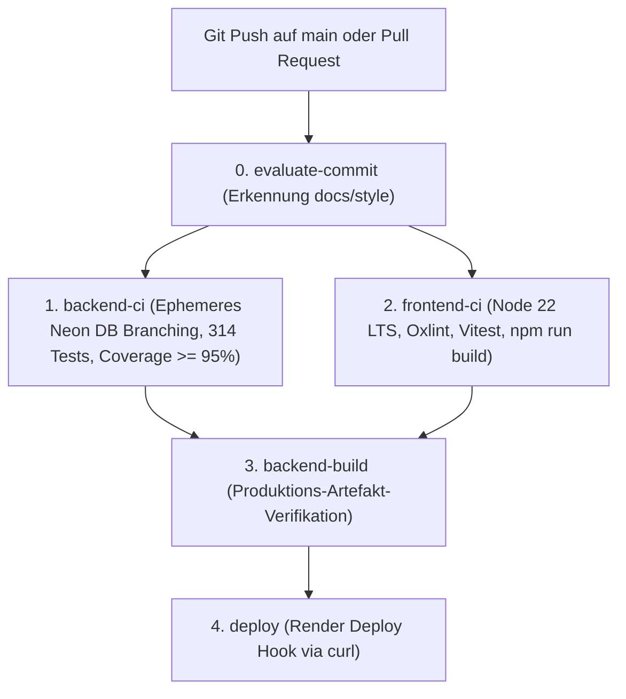

# Deployment & DevOps Leitfaden

Diese Seite dokumentiert den Verteilungs-, Build- und Betriebsprozess auf [Render](https://render.com/) und die CI/CD-Pipeline in GitHub Actions.

---

## 1. Hosting-Architektur auf Render

Das Projekt wird deklarativ über [render.yaml](../../render.yaml) verwaltet:

1. **Backend Web Service (`portfolio-backend`)**:
   - Runtime: Python 3.13 mit Gunicorn.
   - Root-Verzeichnis: `backend/`.
   - Build-Kommando: `./build.sh` (führt `uv sync --frozen`, `collectstatic`, `migrate` und `index_rag_chunks` aus).
   - Start-Kommando: `gunicorn core.wsgi:application --bind 0.0.0.0:$PORT --workers 2`.
   - Auto-Deploy: `off` (wird ausschließlich durch erfolgreiche GitHub Actions Pipelines getriggert).
   - Health-Check: `/health_check`.

2. **Frontend Static Site (`portfolio-frontend`)**:
   - Runtime: Node.js (Static Web Server).
   - Root-Verzeichnis: `frontend/`.
   - Build-Kommando: `npm ci && npm run build`.
   - Veröffentlichungs-Verzeichnis: `frontend/dist`.
   - Routing: SPA Rewrite Rule (`/*` -> `/index.html`).

---

## 2. GitHub Actions CI/CD Pipeline (`.github/workflows/ci.yml`)

Die Pipeline nutzt eine Concurrency-Gruppe mit `cancel-in-progress: true` und führt folgende Stufen aus:

### 2.1 Ephemeres Neon DB Branching in der CI

Zur Vermeidung von Mock-Inkonsistenzen laufen Backend-Tests gegen echtes PostgreSQL:
- Die GitHub Action nutzt `neondatabase/create-branch-action@v5`.
- Jeder CI-Lauf erzeugt einen isolierten Branch: `ci-${{ github.run_id }}-${{ github.run_attempt }}`.
- Tests verbinden sich über die direkte Compute-URL, wodurch PgBouncer-Locks bei DDL-Operationen und `pgvector` HNSW-Index-Erstellung ausgeschlossen sind.
- Ein `always()`-Schritt garantiert die rückstandslose Löschung des Test-Branches nach Testende.

### 2.2 Intelligenter Skip-Mechanismus (`evaluate-commit`)

Reine Dokumentationsänderungen (`docs: ...`) oder Formatierungsänderungen (`style: ...`) überspringen automatisch den teuren Produktions-Build (`backend-build`) und das Server-Deployment (`deploy`), während Qualitäts- und Lint-Checks weiterhin laufen.

---

## 3. Benötigte Secrets & Umgebungsvariablen

| Variable | Scope | Beschreibung |
|---|---|---|
| `DATABASE_URL` | Render Backend | Gepoolte Neon PostgreSQL Verbindungs-URL (für Webserver) |
| `DIRECT_DATABASE_URL` | Render Backend | Direkte Neon PostgreSQL URL (für Migrationen in `build.sh`) |
| `SECRET_KEY` | Render Backend | Django Secret Key für kryptografische Signaturen |
| `GEMINI_API_KEY` | Render Backend | API-Key für Gemini 3.8 Flash RAG & Embeddings |
| `USE_SUPABASE_S3` | Render Backend | `True` aktiviert S3-kompatiblen Supabase Storage |
| `AWS_ACCESS_KEY_ID` | Render Backend | Supabase S3 Access Key |
| `AWS_SECRET_ACCESS_KEY` | Render Backend | Supabase S3 Secret Key |
| `AWS_STORAGE_BUCKET_NAME`| Render Backend | Name des Storage Buckets (z. B. `portfolio-media`) |
| `AWS_S3_ENDPOINT_URL` | Render Backend | S3 API Endpunkt von Supabase |
| `NEON_PROJECT_ID` | GitHub Secret | Projekt-ID für ephemere Neon CI-Branches |
| `NEON_API_KEY` | GitHub Secret | API-Key zur Verwaltung der Neon Branches |
| `RENDER_DEPLOY_HOOK_URL`| GitHub Secret | Webhook-URL zum Starten des Render Deployments |

---

## 4. Code Ownership & PR Governance (`.github/CODEOWNERS`)

Kritische Systembereiche erfordern zwingende Reviews von `@dfluechter`:
- `/.github/workflows/`, `/render.yaml`, `build.sh` (CI/CD & Deployment)
- `/backend/core/settings.py`, `/backend/portfolio/migrations/` (Security & Schema)
- `/frontend/src/api/`, `/frontend/src/context/` (Auth & State)
- `/AGENTS.md`, `/.agents/`, `/docs/` (Governance & Schutzregeln)
