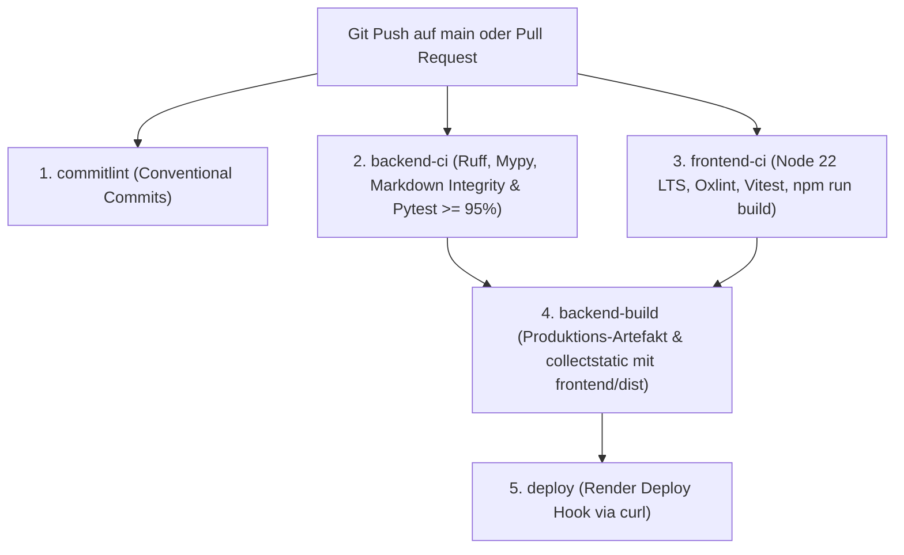

# Deployment & DevOps Leitfaden

Diese Seite dokumentiert den Verteilungs-, Build- und Betriebsprozess auf [Render](https://render.com/) und die CI/CD-Pipeline in GitHub Actions.

---

## 1. Hosting-Architektur auf Render (Single-Service)

Das Projekt wird deklarativ über [render.yaml](../../render.yaml) als integrierter **Single-Service** verwaltet:

1. **Backend & Integrierte React SPA (`portfolio-backend`)**:
   - Runtime: Python 3.13 mit Gunicorn & WhiteNoise.
   - Root-Verzeichnis: `backend/`.
   - Build-Kommando: `./build.sh` (führt `uv sync --frozen --no-dev`, `manage.py check`, den React-Frontend-Build `npm ci && npm run build`, `collectstatic`, `migrate` und `index_rag_chunks` aus).
   - Start-Kommando: `uv run gunicorn core.wsgi:application --bind 0.0.0.0:$PORT --workers 2 --threads 4`.
   - Auto-Deploy: `off` (wird ausschließlich durch erfolgreiche GitHub Actions Pipelines getriggert).
   - Health-Check: `/health_check`.

---

## 2. GitHub Actions CI/CD Pipeline (`.github/workflows/ci.yml`)

Die Pipeline nutzt eine Concurrency-Gruppe mit `cancel-in-progress: true` und führt folgende 5 Stufen aus:

### 2.1 Qualitätssicherung & Produktions-Artefakt-Verifikation

- **Backend-CI**: Führt Ruff, Mypy, `scripts/verify_markdown_integrity.py` sowie alle Backend-Tests mit `--cov=core --cov=portfolio --cov-fail-under=95` aus.
- **Frontend-CI**: Prüft Oxlint, 117+ Vitest-Tests und kompiliert das Produktions-Bundle (`frontend/dist/`), welches als Artefakt an `backend-build` übergeben wird.
- **Backend-Build**: Verifiziert `manage.py check --deploy`, `makemigrations --check --dry-run` und `collectstatic --noinput` inklusive des gebauten Frontend-Bundles.

### 2.2 Render `buildFilter`

Reine Dokumentationsänderungen (`docs/**`, `README.md`, `backend/**/*.md`) sind in `render.yaml` unter `ignoredPaths` konfiguriert, um unnötige Server-Rebuilds zu vermeiden.

---

## 3. Benötigte Secrets & Umgebungsvariablen

| Variable | Scope | Beschreibung |
|---|---|---|
| `DATABASE_URL` | Render Backend | Gepoolte Neon PostgreSQL Verbindungs-URL (für Webserver) |
| `DIRECT_DATABASE_URL` | Render Backend | Direkte Neon PostgreSQL URL (für Migrationen in `build.sh`) |
| `SECRET_KEY` | Render Backend | Django Secret Key für kryptografische Signaturen |
| `DJANGO_ALLOWED_HOSTS` | Render Backend | Erlaubte Hostnamen (`dfluechter.ipv64.de,dfluechter.onrender.com,...`) |
| `CORS_ALLOWED_ORIGINS` | Render Backend | Erlaubte CORS-Origins (`https://dfluechter.ipv64.de,https://dfluechter.onrender.com`) |
| `CSRF_TRUSTED_ORIGINS` | Render Backend | Vertrauenswürdige CSRF-Origins (`https://dfluechter.ipv64.de,https://dfluechter.onrender.com`) |
| `GEMINI_API_KEY` | Render Backend | API-Key für Google Gemini RAG & Embeddings |
| `GEMINI_MODEL` | Render Backend | Konfiguriertes Gemini-Modell (`gemini-2.5-flash`) |
| `GEMINI_EMBEDDING_MODEL`| Render Backend | Konfiguriertes Embedding-Modell (`gemini-embedding-001`) |
| `GEMINI_DAILY_TOKEN_LIMIT` | Render Backend | Tägliches Token-Limit (`50000`) |
| `GEMINI_DAILY_REQUEST_LIMIT` | Render Backend | Tägliches KI-Request-Limit (`100`) |
| `USE_SUPABASE_S3` | Render Backend | `True` aktiviert S3-kompatiblen Supabase Storage |
| `AWS_ACCESS_KEY_ID` | Render Backend | Supabase S3 Access Key |
| `AWS_SECRET_ACCESS_KEY` | Render Backend | Supabase S3 Secret Key |
| `AWS_STORAGE_BUCKET_NAME`| Render Backend | Name des Storage Buckets (z. B. `portfolio-media`) |
| `AWS_S3_ENDPOINT_URL` | Render Backend | S3 API Endpunkt von Supabase |
| `RENDER_DEPLOY_HOOK_URL`| GitHub Secret | Webhook-URL zum Starten des Render Deployments |

---

## 4. Code Ownership & PR Governance (`.github/CODEOWNERS`)

Kritische Systembereiche erfordern zwingende Reviews von `@dfluechter`:
- `/.github/workflows/`, `/render.yaml`, `build.sh` (CI/CD & Deployment)
- `/backend/core/settings.py`, `/backend/portfolio/migrations/` (Security & Schema)
- `/frontend/src/api/`, `/frontend/src/context/` (Auth & State)
- `/AGENTS.md`, `/.agents/`, `/docs/` (Governance & Schutzregeln)
