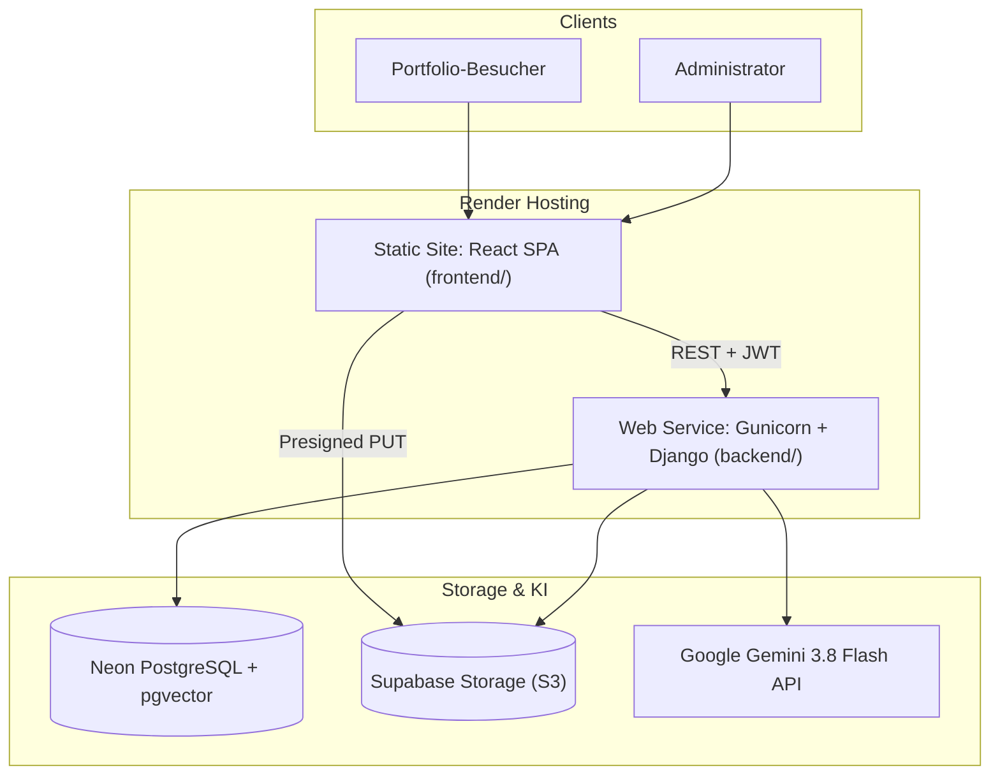

# Willkommen im Portfolio Project Wiki

Dieses Wiki ist das zentrale Referenz- und Architekturdokumentations-Handbuch für das **Portfolio-Projekt von Dominik Flüchter**. Es bietet Entwicklern, Maintainern und Interessierten einen strukturierten Einblick in Systemarchitektur, Datenflüsse, RAG-KI-Copilot, Sicherheitsrichtlinien und Entwicklungsprozesse.

---

## 🌟 Schnellnavigation

| Thema | Dokument | Kurzbeschreibung |
|---|---|---|
| **System-Architektur** | [System-Architecture](System-Architecture) | Monorepo, Headless Django REST API, React SPA, Neon DB & Supabase S3 |
| **RAG Copilot & KI** | [RAG-Portfolio-Copilot](RAG-Portfolio-Copilot) | Google Gemini 3.8 Flash, `text-embedding-004`, Neon `pgvector` HNSW & Guardrails |
| **Frontend** | [Frontend-Architecture](Frontend-Architecture) | React 19, TypeScript, Tailwind v4, TanStack Query & Code-Splitting |
| **DevOps & CI/CD** | [Deployment-and-Operations](Deployment-and-Operations) | Render Deployment, Ephemeres Neon DB-Branching & Git-Governance |
| **Sicherheit** | [Security-Policy](Security-Policy) | Defense-in-Depth, strikter Read-Only Schutz für Zertifikate & Magic Bytes |
| **Entwicklung** | [Developer-Guide](Developer-Guide) | Lokales Setup, uv, Python 3.13, Node 22 LTS & Test-Ausführung |
| **Planung & Roadmap** | [Product-Backlog-and-Roadmap](Product-Backlog-and-Roadmap) | Epics 1 bis 15, User Stories, DoR / DoD und BDD-Akzeptanzkriterien |
| **Fachbegriffe** | [Glossary](Glossary) | Verbindliches Glossar über Entitäten, Lifecycle & Vektorsuche |

---

## 🏗️ System-Überblick

Das Projekt ist als cloud-natives Monorepo organisiert:
- **Backend (Headless JSON API)**: Entwickelt mit **Python 3.13**, **Django 5.2+** und dem **Django REST Framework (DRF)**.
- **Frontend (Single Page Application)**: Entwickelt mit **React 19**, **TypeScript 5.8**, **Vite 8** und **Tailwind CSS v4**.
- **Datenbank & Vektorspeicher**: **Neon Serverless PostgreSQL** mit nativer **`pgvector`** Extension (768-dim. HNSW-Kosinusindex) in der Produktion; lokaler SQLite-Fallback mit automatischem Keyword-Retrieval.
- **Media-Storage**: **Supabase Storage (S3-kompatibel)** mit Presigned Direct-Uploads und serverseitiger Magic-Byte-Integritätsprüfung.
- **Hosting**: Automatisches Deployment auf **Render** (Static Site für Frontend, Gunicorn Web Service für Backend).



---

## 🎯 Kern-Features

1. **RAG Portfolio-Copilot (`/api/ai/chat/`)**:
   - Semantische Beantwortung von Besucherfragen strictly grounded in Portfolio-Daten.
   - HNSW-Vektorsuche über Projekte, Skills, Zertifikate und Werdegang.
   - Zero-Cost Guardrails gegen Prompt Injections (0-Token Pre-Flight Drop).
   - Klickbare Deep-Link Badges mit optischem Scroll- und Glow-Highlight im UI.

2. **Zertifikats-Lifecycle & 3-Stufen Hybrid OCR**:
   - **Presigned Direct-to-Storage (Supabase S3)**: Uploads aus dem Browser erfolgen über eine signierte PUT-URL direkt an den S3-Storage, was den Web-Server entlastet.
   - **Serverseitige S3-Integritätsprüfung**: Vor Registrierung eines `storage_key` prüft das Backend via `head_object` Existenz und Dateigröße ($\le 10\text{ MB}$). Ein Range-Request (`bytes=0-2047`) verifiziert die Magic Bytes (`%PDF`, `\x89PNG`, `\xFF\xD8\xFF`) gegen Dateiendungs-Spoofing. Zudem wird die SHA-256-Prüfsumme validiert.
   - **Kaskadierende 3-Stufen-OCR**: Die Metadatenextraktion erfolgt im Review-Drawer bei Bedarf stufenweise:
     - **Stufe 1**: Lokaler PDF-Textlayer (`pypdf`).
     - **Stufe 2**: Lokale Tesseract-OCR (`pytesseract`).
     - **Stufe 3**: Multimodale Google Gemini Flash Vision API.
   - **Track-Pflicht & Icon-Caching**: Bevor ein Zertifikat veröffentlicht werden kann (`is_published=True`), muss ihm mindestens ein Fachbereich (Track) zugewiesen sein. Die zugehörigen FontAwesome SVG-Icons werden beim Erstabruf validiert und lokal unter `/static/img/icons/` geordnet gespeichert.

3. **Infrastruktur, Performance & CI/CD-Pipelines**:
   - **Neon Connection Separation**: Web-Requests nutzen zur Skalierung den PgBouncer-Pooler (`DATABASE_URL`). Datenbank-Migrationen (`migrate` in `build.sh`) verwenden automatisch die direkte Compute-Verbindung (`DIRECT_DATABASE_URL`).
   - **Ephemeres Neon Branching in GitHub Actions**: CI-Pipeline-Läufe erstellen einen isolierten Datenbank-Branch (`ci-${{ github.run_id }}-${{ github.run_attempt }}`). Nach Ausführung der Testsuite gegen echtes PostgreSQL inkl. `pgvector` wird dieser Branch automatisch verworfen.
   - **Performance & Frontend Cold-Start-UX**: Die Admin-Komponenten (`DashboardPage`, `LoginPage`, `PasswordResetConfirmPage`) werden träge nachgeladen (`React.lazy`). Bei Nutzung der kostenlosen Server-Instanz auf Render weist ein `ColdStartBanner` den Nutzer auf das Aufwachen des Containers hin.

---

## 🚀 Quickstart für Entwickler

```bash
# 1. Repository klonen
git clone https://github.com/dfluechter/portfolio_project.git
cd portfolio_project

# 2. Backend einrichten (Terminal 1)
cd backend
uv sync
cp ../.env.example ../.env
uv run python manage.py migrate
uv run python manage.py index_rag_chunks
uv run python manage.py createsuperuser
uv run python manage.py runserver

# 3. Frontend einrichten (Terminal 2)
cd ../frontend
npm install
npm run dev
```

* **Frontend**: `http://localhost:3000`
* **Backend API**: `http://localhost:8000/api/`
* **Swagger-UI**: `http://localhost:8000/api/docs/`
