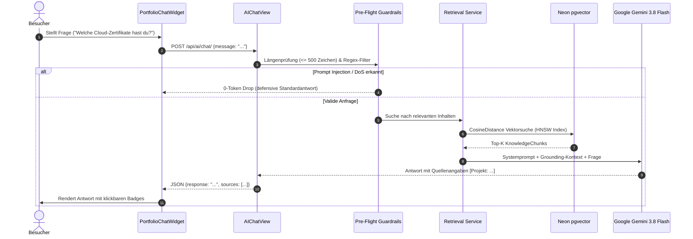

# RAG Portfolio-Copilot & pgvector Hybrid Retrieval

Der Portfolio-Copilot (`POST /api/ai/chat/`) ermöglicht Besuchern, interaktive Fragen über Projekte, Fähigkeiten, Werdegang und Qualifikationen zu stellen. Das System nutzt Retrieval-Augmented Generation (RAG) mit strikter Faktenbindung an verifizierte Daten.

---

## 1. Kernkomponenten & Datenfluss

---

## 2. Semantisches Chunking (`KnowledgeChunk`)

Das Modell `KnowledgeChunk` bildet das Herzstück des semantischen Wissensspeichers:

- **Quellen-Entitäten**:
  - `Project`: Titel, Beschreibung, Technologien, Aufgaben.
  - `Certificate`: Titel, Aussteller, Datum, Tracks, OCR-Volltexte aus `source_pending`.
  - `Skill`: Name, Kategorie, Erfahrungslevel.
  - `TimelineEntry`: Rolle, Organisation, Zeitraum, Beschreibung.
- **Vektor-Einbettung**:
  - Modell: `text-embedding-004` über das offizielle `google-genai` SDK.
  - Dimensionen: 768.
  - Index-Typ: **HNSW (Hierarchical Navigable Small World)** mit Metrik `vector_cosine_ops`.
  - Entwickler-Fallback: Auf SQLite (lokale Entwicklung) oder bei abwesendem API-Key erfolgt ein nahtloser Keyword-basierter Fallback.

---

## 3. $O(1)$ Signals Synchronisation & Cache-Invalidierung

Um zu gewährleisten, dass der KI-Kontext stets synchron mit der relationalen Datenbank ist:
1. **Django Signals** (`post_save`, `post_delete` in `portfolio/signals.py`):
   - Ändert der Administrator ein Projekt oder Zertifikat, synchronisiert der Signal-Handler den `KnowledgeChunk` automatisch.
   - Der globale Version-Cache-Key `portfolio_rag_context_version_v1` wird atomar inkrementiert.
2. **Versioniertes Response-Caching**:
   - Antworten werden mit Schlüssel `portfolio_ai_resp_v{version}_{hash}` zwischengespeichert.
   - Bei jeder Datenänderung invalidieren sämtliche Cache-Einträge in $O(1)$, ohne teure Wildcard-Deletes.

---

## 4. Sicherheits-Guardrails & Zero-Cost Circuit Breaker

Zum Schutz vor Missbrauch, Jailbreaks und unkontrollierten LLM-Kosten:
- **Längenbegrenzung**: Anfragen über 500 Zeichen werden mit `400 Bad Request` abgewiesen.
- **0-Token Injection Drop**: Pre-Flight Regex-Muster erkennen Versuche zur Systemprompt-Extraktion oder Befehlsumgehung (*"Ignore all previous instructions"*). Diese Anfragen werden ohne API-Aufruf zu Gemini abgewehrt (0 Kosten, 0 LLM-Tokens).
- **Strikte Systemprompt-Bindung**: Gemini wird instruiert, keine externen Annahmen zu treffen und ausschließlich aus dem bereitgestellten Portfolio-Kontext zu zitieren.
- **Tägliche Budgets**: Rate-Limiting limitiert Requests pro IP und Tag.

---

## 5. UI Deep-Linking Badges

Generierte Antworten enthalten Quellverweise (z. B. `[Projekt: Cloud Migration]` oder `[Zertifikat: AWS Solutions Architect]`). 

Das Frontend (`PortfolioChatWidget.tsx`):
1. Erkennt diese Tags und wandelt sie in interaktive Badges um.
2. Klick auf ein Badge scrollt die Seite sanft zum Zielelement (`#project-<id>` bzw. `#cert-<id>`).
3. Das Zielelement erhält einen 2-Sekunden visuellen Glow-Ring (`ring-2 ring-blue-500 shadow-lg`), sodass der Besucher die Aussage visuell überprüfen kann.
