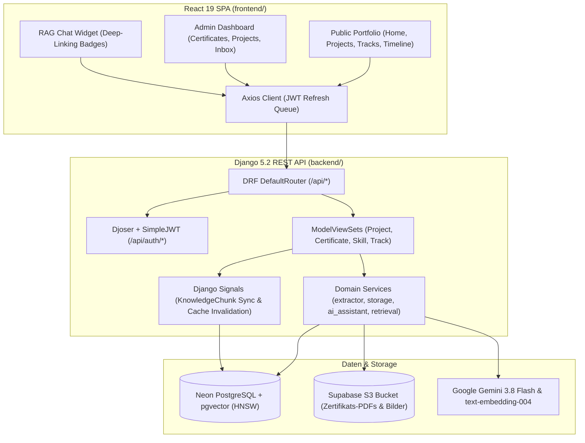
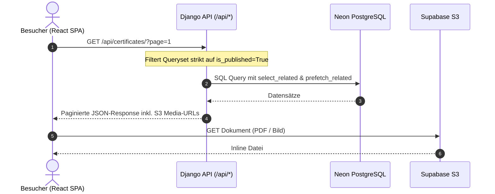
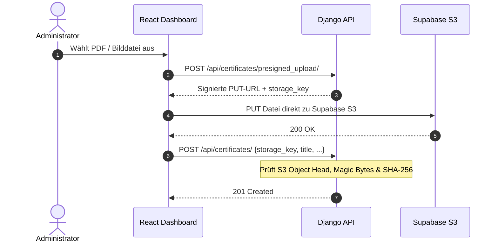

# System- und Komponenten-Architektur

Diese Seite beschreibt die Gesamtsystemarchitektur, Schnittstellen und Datenflüsse des Portfolio-Projekts.

---

## 1. Architektur-Prinzipien

Das Portfolio folgt modernen Cloud-Native- und Headless-Mustern:
- **Headless JSON REST-API**: Das Backend ([Django 5.2](https://www.djangoproject.com/)) liefert ausschließlich JSON-APIs. Django-HTML-Templates wurden vollständig abgelöst.
- **Single Page Application (SPA)**: Die Benutzeroberfläche (öffentliches Portfolio & Admin-Dashboard) ist eine clientseitige [React 19](https://react.dev/)-Anwendung.
- **Connection Separation**: Bei der Verbindung zu [Neon PostgreSQL](https://neon.tech/) werden gepoolte Verbindungen (`DATABASE_URL`, PgBouncer) für den regulären Webbetrieb und direkte Verbindungen (`DIRECT_DATABASE_URL`) für Schema-Migrationen und DDL-Operationen getrennt.
- **Zero-Storage Load auf Backend**: Datei-Uploads fließen via Presigned S3 URLs direkt zwischen Browser und [Supabase Storage](https://supabase.com/), wodurch der Render-Container schlank und zustandslos bleibt.

---

## 2. Komponenten-Übersicht

---

## 3. Datenflüsse

### 3.1 Öffentliche Leseanfragen

Unauthentifizierte Anfragen sind strikt zustandslos und erhalten ausschließlich Datensätze mit `is_published=True`.

### 3.2 Direct-to-Storage Uploads (Supabase S3)

Uploads laufen zweistufig ab, um den Server vor Bandbreiten-Peaks zu schützen:

---

## 4. REST-API-Endpunkte (Übersicht)

| Endpunkt | Methode | Berechtigung | Beschreibung |
|---|---|---|---|
| `/api/projects/` | `GET`, `POST` | Read: Public / Write: Auth | Projekte mit GitHub/Live-Links |
| `/api/certificates/` | `GET`, `POST` | Read: Public / Write: Auth | Zertifikate mit Server-Paginierung & Filtern |
| `/api/certificates/<id>/publish/` | `POST` | Auth | Validiert Track-Pflicht & publiziert Zertifikat |
| `/api/certificates/<id>/extract_metadata/` | `POST` | Auth | On-Demand 3-Stufen OCR Analyse |
| `/api/pending-certificates/` | `GET`, `POST` | Nur Staff | Inbox-Kandidaten aus Dateiscans |
| `/api/pending-certificates/<id>/file/` | `GET` | Nur Staff | Streamt Originaldatei für Live-Vorschau |
| `/api/tracks/` | `GET`, `POST` | Read: Public / Write: Auth | Fachbereiche inkl. lokaler FontAwesome SVG-Icons |
| `/api/skills/` | `GET`, `POST` | Read: Public / Write: Auth | Qualifikationen & Level |
| `/api/timeline/` | `GET`, `POST` | Read: Public / Write: Auth | Werdegang & Karriere-Stationen |
| `/api/ai/chat/` | `POST` | Öffentlich | RAG Portfolio-Copilot mit Guardrails |
| `/api/auth/jwt/create/` | `POST` | Öffentlich | JWT Login (Access: 60 min, Refresh: 7 Tage) |
| `/api/auth/jwt/refresh/` | `POST` | Öffentlich | Token-Erneuerung |

Die vollständige interaktive Spezifikation ist über Swagger-UI unter `/api/docs/` einsehbar.
